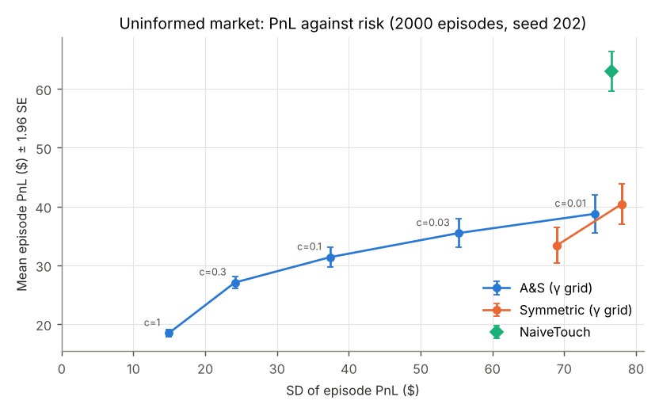
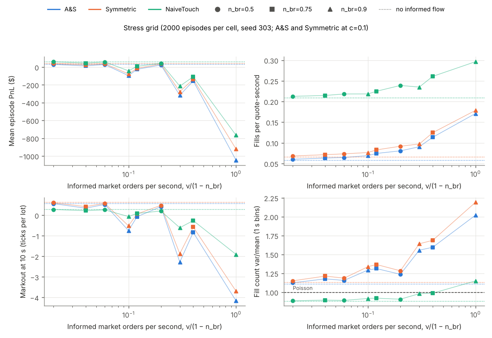

# Limit Order Book Simulator and Market-Making Backtester

A C++17 limit order book with price-time priority; a replayer that reads [LOBSTER](https://lobsterdata.com)-format files and compares the replayed book with the order-book file after every message; an event-driven simulator that tests Avellaneda-Stoikov quoting against symmetric and naive quoting, with and without bursts of informed order flow; and Python bindings.

**Everything reported here comes from simulated or synthetic data.** No real LOBSTER file has been processed yet, and no parameter is calibrated to market data. [What this does not show](#what-this-does-not-show) lists the consequences.

## Status

| Module | What it is | How it is tested | Results | Real data |
|---|---|---|---|---|
| [`core/`](core/README.md) | Order book engine: price-time priority, matching mode and replay mode | Unit tests; randomized differential tests against a slow reference model; mutation check (8 of 8 mutants caught); ASan and UBSan | [`results/core/`](results/core) (benchmarks) | not applicable |
| [`paper/`](paper/README.md) | Replication of the simulation in Avellaneda and Stoikov (2008) | Unit tests; agreement with the paper's own table (see below) | [`results/paper/`](results/paper) | not applicable |
| [`lobster/`](lobster/README.md) | LOBSTER reader, replayer, per-message book validator, synthetic file generator | Unit and allocation tests; end-to-end test against an independent Python book; mutation check (12 of 12 mutants caught) | [`results/lobster/`](results/lobster) (synthetic files) | **not run on a real LOBSTER file** |
| [`backtest/`](backtest/README.md) | Event-driven market simulator, quoting strategies, informed-flow stress test | Unit tests for strategies, Hawkes process, market and experiment driver | [`results/backtest/`](results/backtest) (simulated) | not applicable |
| [`python/`](python/README.md) | pybind11 bindings, package `lobsim` | pytest, including a differential test against a pure-Python book and a type-stub check; mutation check (12 of 12 mutants caught) | [`results/python/`](results/python) | not applicable |

The paper replication: 30 of the 30 statistics compared from the paper's tables lie within 2 standard deviations of a 1000-simulation estimate from this model (`results/paper/agreement.csv`). The paper's table values (`paper/reference/as2008_tables.csv`, read from the PDF) are the only numbers typed in by hand for that comparison.

Continuous integration (GitHub Actions) builds with GCC 13 and Clang 18 in Release mode with warnings as errors, runs every C++ test under AddressSanitizer and UndefinedBehaviorSanitizer (GCC, Debug), and runs the Python tests on Python 3.12 and 3.13.

## Headline results

All simulated or synthetic. Each value is copied from the file in the last column, and `scripts/check_readme_numbers.py` (run in CI) fails if a value here is not found in that file. The backtest numbers come from 2,000 independent 10-minute episodes per strategy and cell. Values with "±" are a mean ± 1.96 standard errors (normal approximation); intervals in square brackets are paired percentile-bootstrap 95% intervals (1,000 replicates, the same episode indices for both strategies). PnL is gross, in USD, for one 100-share lot per side.

| Result | Value | Source |
|---|---|---|
| Uninformed flow, Avellaneda-Stoikov against symmetric quoting at the same risk aversion (skew of 1 tick per lot at mid-horizon): ratio of the standard deviations of PnL | 0.217 [0.205, 0.229] | `results/backtest/tables.md`, Table 4 |
| Same comparison: ratio of the standard deviations of terminal inventory | 0.394 [0.381, 0.408] | Table 4 |
| Same comparison: difference in mean PnL per episode (USD) | -14.9 [-18.0, -11.8] | Table 4 |
| Same comparison split in two: ratio of PnL standard deviations of Avellaneda-Stoikov against a symmetric quoter with the same time-varying spread (inventory skew alone); of that quoter against symmetric quoting (spread term alone) | 0.259 [0.245, 0.272]; 0.837 [0.807, 0.867] | Table 7 |
| Same ratio of PnL standard deviations as in the first row, with the estimated decay rate k halved / doubled (1,000 episodes each; 0.209 [0.194, 0.224] unperturbed on the same episodes) | 0.307 [0.279, 0.343] / 0.168 [0.154, 0.183] | Table 9 |
| Uninformed flow: mean PnL ± 1.96 SE (normal approximation, USD), SD of PnL (USD) and mean/SD for Avellaneda-Stoikov and symmetric quoting at a skew of 1 tick per lot, and for the naive touch quoter | A&S 18.5 ± 0.7, 14.9, 1.24; symmetric 33.4 ± 3.0, 69.0, 0.48; naive 62.9 ± 3.4, 76.6, 0.82 | Table 3 |
| Strong informed flow (news rate 0.1 per second, branching ratio 0.9): mean PnL per episode (USD), Avellaneda-Stoikov / symmetric / naive | -1046.6 ± 29.1 / -920.9 ± 27.8 / -765.6 ± 24.9 | Table 5 |
| Same cell: Avellaneda-Stoikov minus symmetric (USD); ratio of the standard deviations of PnL | -125.8 [-134.7, -115.8]; 1.047 [1.031, 1.063] | Table 6 |
| Same cell, same ratio, smallest and largest over the four perturbations of k and σ (1,000 episodes each) | 1.013 [0.994, 1.036] to 1.160 [1.128, 1.193] | Table 9 |
| Bootstrap Monte Carlo error: largest move of a headline interval endpoint when recomputed with 10,000 instead of 1,000 replicates, as a share of the interval width | 3.5% | Table 10 |
| Order book engine, replay of 20 million synthetic messages: median messages per second, GCC 13 Release, shared 2-core VM | 1.614e+07 (62.0 ns per message) | `results/core/bench.txt` |
| LOBSTER-format replay, 2,000,000 synthetic messages with 10 levels: median messages per second for parse plus replay, and for parse plus replay plus validation against the order-book file | 3.72e+06 and 8.05e+05 | `results/lobster/tables.md`, Table 5 |
| Rows of synthetic LOBSTER files whose replayed book differs from the file (six files of 500,000 messages, 1, 5 and 10 levels, strict policy) | 0 of 3,000,000 | `results/lobster/tables.md`, Table 1 |
| Python bindings: bulk replay of 5,000,000 synthetic messages, median messages per second; one scalar call (`submit_limit` plus `cancel`), median ns per pair | 1.469e+07; 714.1 ns | `results/python/bench.txt` |



*Figure 1. Simulated market, 2,000 episodes per point (`results/backtest/frontier_uninformed.png`). Blue points are Avellaneda-Stoikov at each risk aversion, labelled by the skew c in ticks per lot at mid-horizon (larger c, more risk averse). Orange points are symmetric quoting at the same risk aversions; several coincide because the quotes are rounded to ticks. The green diamond is the naive touch quoter. Bars are the mean ± 1.96 standard errors (normal approximation).*



*Figure 2. Simulated market with Hawkes bursts of informed flow, 2,000 episodes per cell (`results/backtest/stress.png`). Circles, squares and triangles are branching ratios 0.5, 0.75 and 0.9; dotted lines show the same strategy without informed flow. Avellaneda-Stoikov and symmetric quoting at c = 0.1.*

**Reading.** With uninformed order flow, Avellaneda-Stoikov quoting does what the model says it should: it shrinks the variance of PnL and of inventory, and pays for it with a lower mean PnL. Most of the variance reduction comes from the inventory skew, not from the spread that narrows towards the horizon: a symmetric quoter given the same time-varying spread lowers the standard deviation of PnL only to 0.837 of the benchmark's at the largest risk aversion, against 0.259 for the skew on top of it. The size of the reduction depends on the estimated decay rate k (at that risk aversion the ratio is between 0.168 and 0.307 when k is halved or doubled), but no perturbation tested removes it. With enough informed flow every strategy loses money on average. In the cell listed above the variance reduction is gone (the ratio of PnL standard deviations is above 1), and Avellaneda-Stoikov loses more than the symmetric quoter and has the worst 10-second markout. The model assumes uninformed Poisson fills; the stress test breaks that assumption. The naive quoter, which joins the touch, has the highest mean PnL in the uninformed baseline and still loses money when the informed flow is strong. These are results about this simulator, not about real markets.

## What this does not show

- **Nothing about real markets.** The background flow is a zero-intelligence model with constant rates; the volatility and the arrival-intensity decay used by the strategy are estimated from the simulator itself; the informed flow is a Hawkes burst model whose parameters were chosen to produce a stress, not estimated. A profitable cell in a table is not evidence that a strategy makes money.
- **Nothing about real LOBSTER data.** The replayer is tested against files from the synthetic generator in `lobster/tools/`, whose book is an independent Python implementation; both were written for this repository, so agreement shows consistency between two implementations, not correctness against the vendor's data. The format notes in `docs/design.md` are taken from LOBSTER's public documentation and have not been checked against a real file. Real files may contain cases that neither side of the test has met.
- **Simplified execution.** One asset, one lot per side, no fees or rebates, a fixed latency, no venue queueing, mark-to-market at the mid. The Avellaneda-Stoikov parameters are estimated in-sample on the same simulator.
- **Limited sensitivity analysis.** The decomposition into skew and spread term and the sensitivity to the estimated volatility and decay rate are run in one simulator, for one asset, with one-at-a-time perturbations of fixed size in three cells; joint misestimation, other risk aversions in the stress grid, and inputs estimated under informed flow are not run. Intervals are per comparison, not corrected for the number of comparisons.
- **Not an adverse-selection-free market.** In the uninformed baseline every strategy's fills are followed by a move of the mid against it (the 10-second markout is below the spread captured, Table 3 of `results/backtest/tables.md`); the half-spread covers it, so average markouts stay positive.
- **Timing numbers are indicative.** They come from a shared 2-core cloud VM; the load average at the start and end of each benchmark is recorded in the output file.

## Build, test, reproduce

```sh
cmake -S . -B build -G Ninja -DCMAKE_BUILD_TYPE=Release -DLOB_WERROR=ON
cmake --build build
ctest --test-dir build --output-on-failure
```

Requirements: CMake 3.16 or later, Ninja (or drop `-G Ninja`), and GCC 13 or Clang 18. The Python module is built when Python development headers and pybind11 3.0 or later are found (`pip install pybind11 numpy pytest`); otherwise it is skipped with a message, and the Python and end-to-end LOBSTER tests are reported as skipped (exit status 77) when Python, numpy or pytest is missing, so `ctest` can pass without having run them. `-DLOB_MODULES="core;paper;lobster"` selects modules, `-DLOB_SANITIZE=ON` adds the sanitizers. The module READMEs build one module (and what it depends on) into `build-<module>` so that each can be worked on separately.

Every result is regenerated from a committed tree by a script that writes the commands, seeds, commit and machine load next to the output:

```sh
paper/reproduce.sh build       # about 30 s
lobster/reproduce.sh build     # about 5 min
backtest/reproduce.sh build    # about 20 min on an idle core
python3 python/bench/bench_bindings.py --out results/python/bench.txt   # needs PYTHONPATH=build/python
```

The mutation checks (`core/tests/mutation_check.py`, `lobster/tests/mutation_check.py`, `python/tests/mutation_check.py`) apply deliberate bugs to a temporary copy of the sources and report whether the tests notice.

## Layout

| Directory | Contents |
|---|---|
| [`core/`](core/README.md) | Order book engine and benchmark |
| [`paper/`](paper/README.md) | Replication of Avellaneda and Stoikov (2008) |
| [`lobster/`](lobster/README.md) | LOBSTER replay and validation, synthetic generator, independent Python reference book |
| [`backtest/`](backtest/README.md) | Simulator, strategies, Hawkes stress test |
| [`python/`](python/README.md) | pybind11 bindings and Python package |
| [`common/`](common) | Header-only basics: types, random number generator, test harness |
| [`results/`](results) | Generated tables, figures and manifests, one directory per module |
| [`docs/design.md`](docs/design.md) | Conventions and module contracts |

## References

- M. Avellaneda and S. Stoikov (2008), "High-frequency trading in a limit order book", *Quantitative Finance* 8(3), 217-224. Reservation price $r(s,q,t) = s - q\gamma\sigma^2(T-t)$ and total quoted spread $\gamma\sigma^2(T-t) + \frac{2}{\gamma}\ln\left(1 + \frac{\gamma}{k}\right)$, with $q$ the inventory, $\gamma$ the risk aversion, $\sigma$ the volatility and $k$ the decay rate of order-arrival intensity.
- R. Cont, S. Stoikov and R. Talreja (2010), "A stochastic model for order book dynamics", *Operations Research* 58(3), 549-563. The background order flow follows the zero-intelligence style of this paper; see `backtest/README.md` for what is and is not taken from it.
- A. G. Hawkes (1971), "Spectra of some self-exciting and mutually exciting point processes", *Biometrika* 58(1), 83-90. The informed flow is a Hawkes process.
- [LOBSTER](https://lobsterdata.com) file format, from the public documentation.

## Disclaimer

Educational project. Not investment advice.
