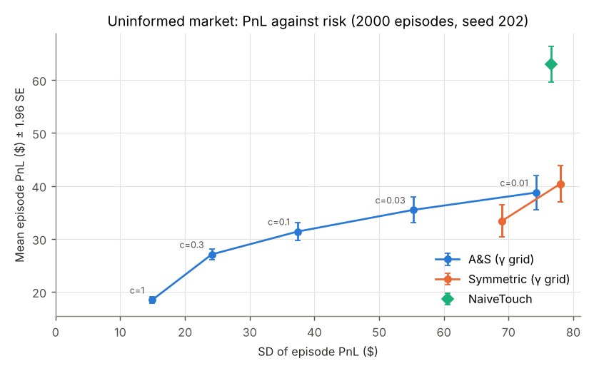
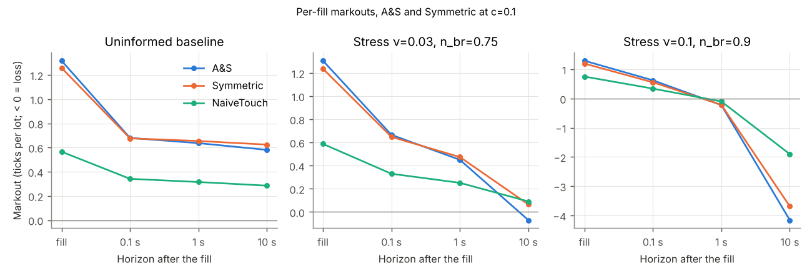
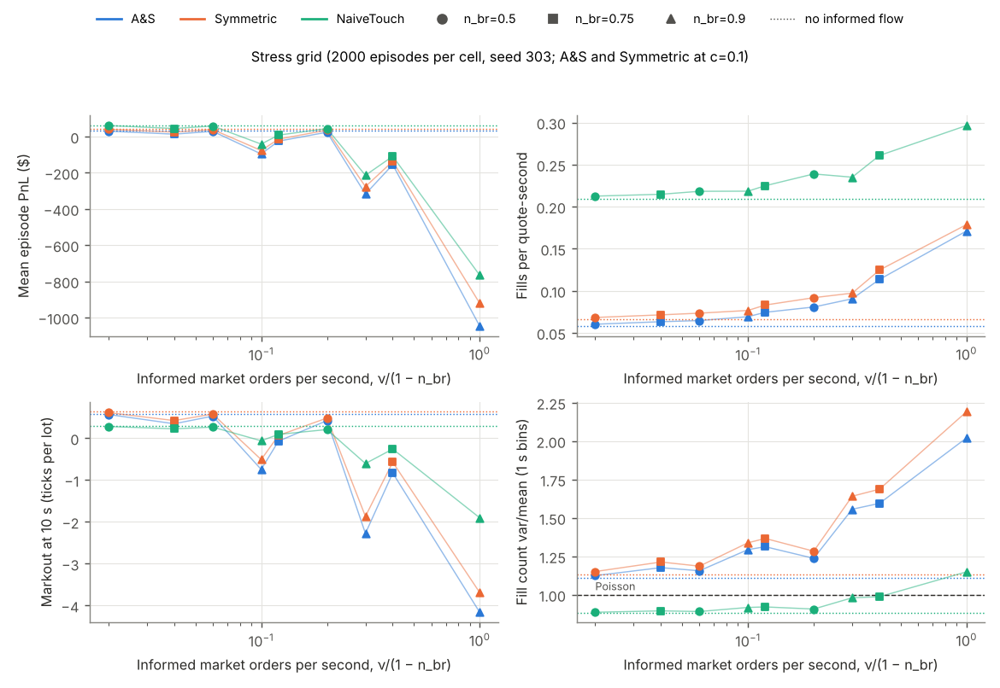
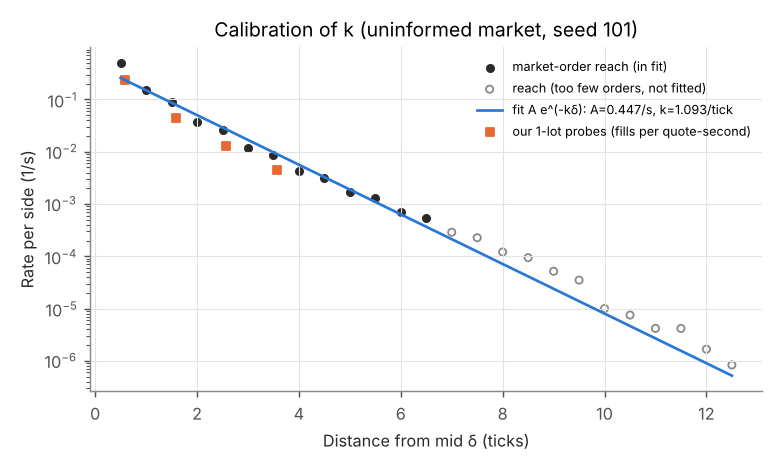

# backtest: market-making simulation with uninformed and informed order flow

An event-driven limit-order-book simulator built on `lob::OrderBook` (matching mode), in which the
Avellaneda-Stoikov (A&S) inventory strategy is compared with a symmetric benchmark and a naive
touch-joining quoter, first under uninformed (Poisson) flow and then under informed flow that
arrives in Hawkes-process bursts. It measures PnL, inventory risk, fill rate, spread captured and
short-horizon markouts.

**This is a controlled simulation study with stylized parameters.** No parameter is estimated
from, calibrated to or validated against market data (there is none in this repository). The
A&S inputs $\sigma$ and $k$ are estimated from a separate run of the same simulator. The
"market diagnostics" table below is a check that the simulated market is not degenerate, not a
calibration.

## Model

**Units.** 1 tick = \$0.01, reference price 10,000 ticks (\$100). The engine's `Qty` is shares
(repository convention); every simulated order is a whole number of lots of 100 shares, so
1 tick $\times$ 1 lot = \$1. Time is `lob::Time` nanoseconds; parameters are in seconds.

**Timeline of an episode.** A burn-in of $B$ seconds starts from a seeded book (10 levels of
3 lots per side around the reference price) and lets the background flow replace it; it is run
once per episode seed and the burned-in market is copied for each strategy. The episode runs
for $T$ seconds with our strategy active. At $T$ our orders are cancelled and the PnL is marked.
The market then runs 10 more seconds without us, only so that fills near $T$ get their 10 s
markout.

**Background limit orders** (zero-intelligence rule in the style of Cont, Stoikov and Talreja
2010). On each side, limit orders arrive as a Poisson process; the order lands at distance
$i \in \{1, \dots, K\}$ ticks from the *opposite* best price with rate
$$\lambda_L(i) = \lambda_0\, i^{-\alpha},$$
so a buy order is placed at $a_t - i$ and a sell order at $b_t + i$ ($a_t, b_t$ the public best
prices, the last known one if that side is empty). It therefore never crosses, and $i$ smaller
than the spread places it inside the spread. Sizes are $1 + \mathrm{Geometric}$ lots with mean
$m_L$. Each order cancels after an exponential lifetime with hazard $\theta$ if it has not traded.

**Background market orders** arrive as a Poisson process of rate $\mu$, buy or sell with
probability 1/2, sizes $1 + \mathrm{Geometric}$ with mean $m_M$; they sweep the book through the
engine's price-time priority.

**Informed flow** (stress test). News events arrive as a Poisson process of rate $\nu$, each with
a random direction. Each starts a cluster of same-signed market orders: every order has
$\mathrm{Poisson}(n_{br})$ children, each delayed from its parent by an $\mathrm{Exp}(\beta)$
time (immigrant/offspring representation, simulated exactly). The unsigned order count is a
Hawkes process with intensity
$$\lambda_I(t) = \nu + \sum_{t_j < t} n_{br}\,\beta\, e^{-\beta (t - t_j)},$$
mean intensity $\nu/(1 - n_{br})$ and mean cluster size $1/(1 - n_{br})$. "Informed" here means
directional and autocorrelated: the orders carry no knowledge of a separate fundamental value;
their information content is the price impact they cause in this book.

**Random streams and common random numbers.** Each exogenous ingredient draws from its own
`Rng::for_stream(episode_seed, id)`: bid arrivals (times and distances), ask arrivals, limit
sizes, market orders (times and sides), market sizes, informed times and directions (generated
for the whole run at construction), informed sizes. The lifetime of background order number $c$
is drawn from `Rng::for_stream(lifetime_seed, c)`, so it depends only on the creation count. No
exogenous draw depends on the book or on our orders, so for a given seed the exogenous event
sequence (times, sides, distances, sizes, lifetimes) is identical for every strategy; the
comparisons are paired. The *effect* of these events is not identical: a limit order's price is
relative to the current best price, which our quotes can move, and an order that has traded
cannot be cancelled. The test `exogenous_events_identical_across_strategies` checks the property.
Episode $e$ of an experiment with seed $S$ uses `episode_seed(S, e)`; the stress grid reuses the
same episode seeds in every cell.

**Our orders** rest in the same book as the background orders, with ids from a reserved range
($\ge 2^{62}$) and the engine's real price-time priority. Every `requote` seconds the strategy
returns target quotes; the order manager keeps an order whose price and size are unchanged (queue
position kept) and otherwise cancels it and submits a new one. Cancels and submits take effect
`latency` seconds later, through the event queue. When a submit reaches the book it is rejected
(and counted) if it would cross the public book (post-only) or if inventory plus our resting size
on that side plus the new size would exceed $Q_{max}$ (a pre-trade risk check). Hence our orders
never take liquidity and $|q_t| \le Q_{max}$ at all times.

**The mid.** Throughout, "mid" is the mid of the book *without our own orders* (carried forward
if a side is empty). Strategies, mark-to-market, markouts and realized volatility all use it, so
our own quotes never move the price we are measured against.

**Event order.** Events are processed by (time, class, per-class counter), with exogenous classes
first, so our events never change the relative order of exogenous ones.

### Parameters

Every parameter is a field of `lob::backtest::SimParams` (`include/lob/backtest/params.hpp`) and a
command-line flag of both executables. The table is generated by `backtest_run --list-params`.

<!-- params:begin -->
| Flag | Group | Default | Unit | Rationale (all values stylized) |
|---|---|---|---|---|
| `--horizon` | timing | 600 | s | A&S horizon T; 10 minutes is long enough for inventory to matter |
| `--burn-in` | timing | 300 | s | 100 mean order lifetimes, so the initial book is forgotten |
| `--markout-tail` | timing | 10 | s | longest markout horizon, so fills near T get markouts |
| `--ref-price` | background | 10000 | ticks | 100 USD at 0.01 USD per tick |
| `--lo-rate` | background | 1 | 1/s per side | limit-order rate at distance 1; with theta gives a few lots at the touch |
| `--lo-alpha` | background | 0.5 | - | power-law decay of the rate with distance, the functional form of CST (2010) |
| `--lo-levels` | background | 10 | ticks | orders land within 10 ticks of the opposite best |
| `--cancel-hazard` | background | 0.3 | 1/s | mean lifetime 3.3 s: the book refills within seconds after a sweep |
| `--lo-size-mean` | background | 2 | lots | 1 + Geometric sizes, mean 2 lots |
| `--init-levels` | background | 10 | levels | initial book only; replaced during burn-in |
| `--init-lots` | background | 3 | lots | initial book only; replaced during burn-in |
| `--mo-rate` | background | 1 | 1/s | one market order per second; with the depth gives a spread of 1-2 ticks |
| `--mo-size-mean` | background | 2 | lots | same size law as limit orders, so most market orders stay at the touch |
| `--news-rate` | informed | 0 | 1/s | nu: 0 = no informed flow; the stress grid varies it |
| `--branching` | informed | 0.5 | - | n_br: mean cluster size 1/(1 - n_br); the stress grid varies it |
| `--hawkes-decay` | informed | 2 | 1/s | beta: children follow their parent after 0.5 s on average (seconds-scale bursts) |
| `--inf-size-mean` | informed | 2 | lots | same size law as background market orders |
| `--latency` | trading | 0.001 | s | 1 ms decision-to-book delay (simplified, fixed) |
| `--requote` | trading | 0.1 | s | decision every 100 ms |
| `--max-inventory` | trading | 10 | lots | Q_max: hard position limit |
| `--quote-size` | trading | 1 | lots | one lot per side |
| `--check-every` | checks | 0 | events | engine invariant checks (tests); 0 = off |
<!-- params:end -->

## Strategies

All strategies see only the clock, the public book, the book without their own orders, their own
working orders, their fills and their inventory. Common rules for every strategy: prices are
rounded onto the tick grid away from the mid (bid floored, ask ceiled); post-only clipping
(bid $\le$ best ask $-1$, ask $\ge$ best bid $+1$); 1 lot per side; no bid if
$q + 1 > Q_{max}$, no ask if $q - 1 < -Q_{max}$; requote every 100 ms.

- **AvellanedaStoikov** $\{\gamma, \sigma, k, T\}$: with $s$ the mid, $q$ the inventory in lots
  and $t$ the time since the episode start,
  $$r = s - q\gamma\sigma^2(T - t), \qquad \delta^a + \delta^b = \gamma\sigma^2(T-t) + \tfrac{2}{\gamma}\ln\!\left(1 + \tfrac{\gamma}{k}\right),$$
  quotes $r \mp (\delta^a + \delta^b)/2$. The formulas are the paper module's
  (`lob::paper::QuotingRule`, linked, not copied); units: $\sigma$ in ticks/$\sqrt{\text{s}}$, $k$
  per tick, $\gamma$ per (tick $\cdot$ lot).
- **SymmetricMatched**: quotes $s \mp \bar s/2$, where $\bar s$ is the A&S spread averaged over
  the quoting times (the paper's benchmark, `paper::Strategy::Symmetric`); no inventory term.
- **SymmetricTimeVarying** (`symtv`): quotes $s \mp \delta(t)/2$ with A&S's spread at the current
  time, $\delta(t) = \gamma\sigma^2(T-t) + \tfrac{2}{\gamma}\ln(1 + \gamma/k)$, and no inventory term
  (`paper::Strategy::SymmetricTimeMatched`). It equals A&S whenever $q = 0$, so A&S against it
  isolates the skew and it against SymmetricMatched isolates the time variation of the spread.
- **NaiveTouch**: joins the best bid and best ask of the book without our orders; no inventory
  term.
- **FixedOffset** (probe, calibration only): quotes $s \mp d$.

**Estimating $\sigma$ and $k$.** A separate calibration run of the uninformed market (1000
episodes, no strategy, its own seed) gives

- $\sigma$: realized volatility of the mid sampled every 10 s,
  $\hat\sigma^2 = \sum (\Delta s)^2 / (\text{number of increments} \times 10\,\text{s})$, in
  ticks$^2$/s. The 10 s scale is used because Table 1 shows that the mid is close to a diffusion
  from about 1 s upwards; at 0.1 s bid-ask bounce raises the estimate.
- $k$: A&S assume a quote at distance $\delta$ from the mid is hit at rate $A e^{-k\delta}$. For
  every market order, the *reach* is the distance from the pre-trade mid to its deepest execution
  price. $\lambda(\delta)$ is the rate per side of market orders with reach $\ge \delta$, on the
  half-tick grid $\delta = 0.5, 1, \dots$; $\ln\lambda(\delta)$ is regressed on $\delta$ by
  ordinary least squares over the points with at least 400 orders (Poisson relative error of each
  rate at most 5%).

**Choosing $\gamma$.** The inventory skew of one lot at mid-horizon is
$c = \gamma\sigma^2 T/2$ ticks. The grid is $c \in \{0.01, 0.03, 0.1, 0.3, 1\}$ (half decades),
i.e. $\gamma = 2c/(\hat\sigma^2 T)$: at $c = 0.01$ even an inventory of $Q_{max}$ moves the
reservation price by only 0.1 tick (negligible next to the rounding to whole ticks); at $c = 1$
one lot moves it by a full tick, twice the typical half-spread, so the skew dominates the quote.
The stress test uses the middle value $c = 0.1$. (The history cannot show whether this was fixed
before the stress grid was first run, because the backtest module was committed in one piece.)

## Metrics

Per episode, for our strategy:

- **PnL** (terminal wealth) $= X_T + q_T s_T$ in dollars: cash plus inventory marked at the mid
  at $T$ (initial cash and inventory are zero). Mean, SD, and the Sharpe-like ratio mean/SD of
  episode PnL across episodes.
- **Inventory risk**: SD of $q_T$ across episodes, and the time average of $|q_t|$ (lots).
- **Fills**: number of engine fills on our orders (1 lot each with the default size).
  **Fill rate** = fills / quote-seconds, pooled over episodes, where quote-seconds is the total
  time our orders rested in the book (both sides).
- **Quote distance**: time average of the distance of our resting quotes from the mid (ticks).
- **Spread captured** per fill: $\pm(s_{t^-} - p)$ in ticks, $s_{t^-}$ the mid just before the
  market order that filled us, $+$ for a buy, $-$ for a sell.
- **Markout** at horizon $h$ per fill: $\pm(s_{t+h} - p)$ in ticks, same sign convention, so a
  price move against us after the fill is negative. Horizons 0.1 s, 1 s, 10 s. Pooled over all
  fills (per lot).
- **Fill dispersion**: variance/mean of our fill counts in 1 s bins within an episode, averaged
  over episodes with at least one fill. A Poisson fill process gives 1. Market orders get the
  same statistic in the diagnostics.
- **Paired comparisons** (A vs B on the same episodes): mean PnL difference, SD PnL ratio, SD
  $q_T$ ratio, mean $|q|$ difference, Sharpe difference, fill-rate ratio, markout differences.
  Intervals: paired percentile bootstrap (1000 replicates; each draws episode indices with
  replacement and applies the same indices to A and B; 2.5% and 97.5% type-7 quantiles). A
  replicate whose statistic is not finite is dropped and counted (`replicates_kept`). The
  "± 1.96 SE (normal approximation)" columns are a different kind of interval: mean
  $\pm 1.96\,\mathrm{SD}/\sqrt{n}$ for one strategy.

## How to run

```sh
cmake -S . -B build-backtest -G Ninja -DLOB_WERROR=ON -DLOB_MODULES="core;paper;backtest"
cmake --build build-backtest -j2
ctest --test-dir build-backtest -R backtest --output-on-failure
backtest/reproduce.sh build-backtest   # runs everything, then make_tables.py and plot.py
```

`backtest_run` runs one market configuration for a list of strategies (`none`, `naive`,
`as:<gamma>`, `sym:<gamma>`, `symtv:<gamma>`, `fixed:<ticks>`) on the same episode seeds and writes `run.txt`
(command, seed, all parameters, wall time, load average), `summary.csv`, `diagnostics.csv`,
`comparison.csv` and, with `--calibrate 1`, `calibration.csv` and `reach.csv`. `stress_test` does
the same for every cell of `--nu-grid` $\times$ `--nbr-grid` (plus $\nu = 0$ once). Both print
`--help`. For sensitivity runs, `--k-scale X` and `--sigma-scale X` (default 1) give the as, sym
and symtv arms $k$ = X $\times$ `--as-k` and $\sigma$ = X $\times$ `--as-sigma` while $\gamma$
stays as written in the strategy list; `run.txt` records both scales. `backtest_run --calibrate 1
--calib-blocks N` also writes `calibration_blocks.csv`, $\hat\sigma$ and $\hat k$ on N
consecutive blocks of episodes (each block's $k$ fit on the $\delta$ points of the full fit).
`comparison.csv` has a column `replicates_kept`: the number of bootstrap replicates with a finite
value behind each interval. Output is deterministic for a given seed and build; `log` and `exp` can differ in the
last bit across C libraries, so results on another platform are only statistically identical.

`backtest/reproduce.sh` runs the calibration (seed 101), derives the $\gamma$ grid from
$\hat\sigma$, runs the uninformed baseline (seed 202) and the stress grid (seed 303), the
10,000-replicate interval check and the sensitivity runs (same seeds, `results/backtest/mc_check/`
and `results/backtest/sensitivity/`), records
commands, seeds, git commit and machine load in `results/backtest/MANIFEST.txt`, then calls
`make_tables.py` (tables below and `results/backtest/tables.md`) and `plot.py` (figures).

## Wave 3 analyses (written before they were run)

This section was committed before any of the runs below was made. It fixes every choice of the
three analyses that answer three questions: how much of the A&S variance reduction comes from the
inventory skew and how much from the time-varying spread; how sensitive the results are to the
estimated $\sigma$ and $k$; and whether the intervals are what they say. Nothing below may be
changed after the runs; any deviation is listed at the end of this section with its reason.

**New arm `symtv:<gamma>` (SymmetricTimeVarying).** Quotes $s \mp \delta(t)/2$ with
$\delta(t) = \gamma\sigma^2(T - t) + \tfrac{2}{\gamma}\ln(1 + \gamma/k)$ at the current time $t$
(capped at $T$, as for A&S), $s$ the others' mid, no inventory term. It uses
`lob::paper::QuotingRule` with `paper::Strategy::SymmetricTimeMatched` and the common rules (tick
rounding, post-only clipping, inventory limit, 100 ms requoting). It differs from A&S only by the
skew and from SymmetricMatched only by the time variation of the spread, so
$$\frac{\mathrm{SD}_{A\&S}}{\mathrm{SD}_{Sym}} = \frac{\mathrm{SD}_{A\&S}}{\mathrm{SD}_{SymTV}} \times \frac{\mathrm{SD}_{SymTV}}{\mathrm{SD}_{Sym}}$$
holds exactly for the point estimates (same episodes), for the SD of PnL and of $q_T$.
Regression requirement: adding the arm must leave every `summary.csv` row of the existing arms
byte-identical (same seeds), and the bootstrap streams of the existing pairs unchanged (new pairs
are appended after the existing ones).

**Analysis 1: decomposition.**
- Runs: the uninformed baseline (seed 202, 2000 episodes) gets `symtv:<gamma>` for each of the
  five $\gamma$ values, appended to the existing strategy list; the stress grid (seed 303, 2000
  episodes per cell) gets `symtv:<gamma>` at $c = 0.1$, appended, in every cell (it costs one arm).
- Pairs: A&S against SymTV (isolates the skew) and SymTV against Symmetric (isolates the
  time-varying spread), at the same $\gamma$, with the statistics of Tables 4 and 6 (ratio of SDs
  of PnL, ratio of SDs of $q_T$, difference in mean PnL, difference in mean/SD, mean $|q|$
  difference, 10 s markout difference), paired percentile bootstrap with the same episode indices
  for both arms, the same replicate count as the other comparisons.
- Table: per $c$ in the baseline, and for the stress cells $(0, -)$ and $(0.1, 0.9)$, the three
  rows A&S/Sym, A&S/SymTV, SymTV/Sym and a fourth row with the product of the two factors (point
  estimates only), which must equal the A&S/Sym row. The other stress cells go to `tables.md` only.
- Reading rule: the "skew share" of the reduction in the SD of PnL is
  $\ln(\mathrm{SD}_{A\&S}/\mathrm{SD}_{SymTV}) / \ln(\mathrm{SD}_{A\&S}/\mathrm{SD}_{Sym})$, a point
  estimate (it has no bootstrap interval, because the two factors are bootstrapped on separate
  streams); the two factor intervals are the evidence. The skew carries most of the reduction at a
  given $c$ if the A&S/SymTV ratio is below the SymTV/Sym ratio and their intervals do not
  overlap. The share is reported for every $c$ and both stress cells, whatever it is.

**Analysis 2: sensitivity to $\sigma$ and $k$.**
- New driver options `--k-scale X` and `--sigma-scale X` (default 1) multiply the $k$ and
  $\sigma$ given to the as, sym and symtv arms; $\gamma$ stays at the value written in the strategy
  spec, i.e. the value chosen from the unperturbed $\hat\sigma$, so a perturbation moves both the
  skew and the spread.
- Settings (one input perturbed at a time): $(k, \sigma)$ scales $(1, 1)$, $(0.5, 1)$, $(2, 1)$,
  $(1, 0.8)$, $(1, 1.25)$. The unperturbed setting is rerun at the same episode count so every row
  of the table has the same $n$.
- Cells: uninformed (seed 202) with as, symtv and sym at $c = 0.1$ and at $c = 1$ in one run; the
  stress cell $\nu = 0.1$, $n_{br} = 0.9$ (seed 303) with as, symtv and sym at $c = 0.1$. Same
  seeds as the baseline and stress runs, so episode $e$ is the same episode as there (common random
  numbers across settings and with the main runs).
- 1000 episodes per cell and setting, a compute-budget choice (half the main runs), so the
  intervals are about $\sqrt 2$ wider than in Tables 4 and 6.
- Reported per cell and setting: A&S mean PnL $\pm$ 1.96 SE and SD of PnL; the SD-of-PnL ratios
  A&S/Sym, A&S/SymTV and SymTV/Sym with bootstrap intervals; in `tables.md` also the SD-of-$q_T$
  ratio and the mean PnL difference of A&S against Sym.
- Reading: each perturbed row is compared with the unperturbed row of the same cell. No interval
  is computed for the difference between settings.
- Interval for the estimates themselves: the calibration run (seed 101, 1000 episodes) also
  writes $\hat\sigma$ and $\hat k$ for 10 consecutive blocks of 100 episodes (option
  `--calib-blocks 10`). Each block's $k$ fit uses the same $\delta$ points as the full-sample fit,
  so block differences come from sampling only. Reported: the ten block values, their mean and SD,
  and SD$/\sqrt{10}$ as the standard error of the 1000-episode estimate, compared with the
  perturbations ($k \times 0.5$ and $\times 2$, $\sigma \times 0.8$ and $\times 1.25$). Sampling
  error does not measure misspecification (the exponential misses the touch by about a factor of
  two); that is what the large $k$ perturbations are for.

**Analysis 3: intervals.**
- Every "± 95%" column is relabelled "± 1.96 SE (normal approximation)".
- `comparison.csv` and `stress_comparison.csv` get a column `replicates_kept`, the number of
  finite bootstrap replicates behind each interval; Table 4 shows the smallest count per row. If
  any replicate is dropped anywhere, the README says where.
- Monte Carlo error of the percentile endpoints: three headline intervals are recomputed with
  10,000 replicates on the same episodes (separate runs with only the two arms concerned, same
  seeds): Table 4 SD-of-PnL ratio and SD-of-$q_T$ ratio for A&S against Symmetric at $c = 1$, and
  Table 6 mean PnL difference at $(0.1, 0.9)$. Decision rule: if any of the six endpoints moves by
  more than 5% of the width of the 10,000-replicate interval, the default replicate count is
  raised to 10,000 for every comparison and everything is regenerated; otherwise 1000 stays. Both
  sets of endpoints are reported in one table either way.
- Table 3 and Table 5 get a column "adverse selection per fill (spread captured minus 10 s
  markout, ticks)".

**Multiplicity.** The analyses add 10 baseline pairs, 20 stress pairs and 30 sensitivity pairs,
each with several statistics. The intervals are per-comparison 95% intervals, not corrected for
multiplicity; the reading quotes only the rows named above.

**Compute budget.** The added baseline arms cost about 5 x 2000 episodes, the stress arm 10 x
2000, the sensitivity runs 5 settings x (6 x 1000 + 3 x 1000) arm-episodes, and the Monte Carlo
check 2 x 2 x 2000: all together well under the 40 minutes of one core allowed.

**Deviations from this plan:** none in the analyses. Implementation details the plan did not fix:
`stress_test` no longer accepts `--calibrate` (it was accepted and ignored before); `--k-scale` and
`--sigma-scale` are accepted by both executables. The pre-specified skew share is above 1 in the
stress cell (0.1, 0.9), where the skew raises the SD and the spread term lowers it; it is reported
as computed. The multiplicity count above is wrong for the sensitivity runs: they add 45 pairs
(3 per cell and $c$, 5 settings, 3 cell-$c$ combinations), not 30.

## Results

<!-- tables:begin -->
**Table 1. Market diagnostics** (strategy None; 1000 episodes for the calibration run, 2000 per stress cell, seed 303). σ is realized volatility of the mid in ticks/√s at the given sampling interval; spread and touch depth are time averages of the book without our orders; two-sided is the fraction of time both sides are non-empty; MO var/mean is the dispersion of market-order counts per 1 s bin (1 for Poisson).

| Run (ν, n_br) | Informed MO/s | All MO/s | σ 0.1 s | σ 1 s | σ 10 s | σ 60 s | Spread (ticks) | Touch depth (lots) | Two-sided | MO var/mean |
|---|---|---|---|---|---|---|---|---|---|---|
| calibration (0, -) | 0 | 1.002 | 0.761 | 0.722 | 0.676 | 0.678 | 1.255 | 4.95 | 0.9999 | 1.00 |
| stress (0, -) | 0.000 | 1.001 | 0.763 | 0.720 | 0.673 | 0.669 | 1.255 | 4.96 | 0.9999 | 1.00 |
| stress (0.01, 0.5) | 0.020 | 1.021 | 0.777 | 0.735 | 0.690 | 0.686 | 1.260 | 4.94 | 0.9999 | 1.02 |
| stress (0.01, 0.75) | 0.040 | 1.040 | 0.805 | 0.767 | 0.761 | 0.772 | 1.265 | 4.92 | 0.9996 | 1.12 |
| stress (0.01, 0.9) | 0.108 | 1.109 | 0.898 | 0.886 | 1.101 | 1.255 | 1.275 | 4.91 | 0.9976 | 1.77 |
| stress (0.03, 0.5) | 0.060 | 1.061 | 0.807 | 0.763 | 0.723 | 0.718 | 1.271 | 4.89 | 0.9998 | 1.06 |
| stress (0.03, 0.75) | 0.123 | 1.123 | 0.890 | 0.861 | 0.921 | 0.949 | 1.287 | 4.86 | 0.9989 | 1.34 |
| stress (0.03, 0.9) | 0.298 | 1.299 | 1.107 | 1.127 | 1.574 | 1.845 | 1.313 | 4.82 | 0.9936 | 2.75 |
| stress (0.1, 0.5) | 0.201 | 1.202 | 0.905 | 0.862 | 0.834 | 0.836 | 1.310 | 4.76 | 0.9996 | 1.19 |
| stress (0.1, 0.75) | 0.400 | 1.401 | 1.152 | 1.143 | 1.344 | 1.416 | 1.362 | 4.66 | 0.9965 | 1.87 |
| stress (0.1, 0.9) | 0.993 | 1.994 | 1.717 | 1.772 | 2.642 | 3.126 | 1.450 | 4.54 | 0.9782 | 5.08 |

**A&S estimates** (calibration run, 1000 episodes, seed 101): σ = 0.6764 ticks/√s (10 s returns), k = 1.0930 per tick, A = 0.4467 per second per side, R² of the log-linear fit 0.983 over 13 points. The points are cumulative counts, so each contains the next and they are strongly dependent: R² overstates how well one exponential describes the data, and the fit misses the rate at the touch by about a factor of two (Table 2a), partly by construction, since every market order reaches at least half a tick. No interval is given for k or σ here; Table 8 gives their sampling spread across blocks of episodes.

**Table 2a. k fit.** Rate per side of market orders whose deepest execution is at least δ ticks from the mid before the order.

| δ (ticks) | λ(δ) measured (1/s per side) | A e^{-kδ} fitted | Orders | In fit |
|---|---|---|---|---|
| 0.5 | 0.5008 | 0.2586 | 600992 | yes |
| 1 | 0.1499 | 0.1497 | 179831 | yes |
| 1.5 | 0.0912 | 0.0867 | 109446 | yes |
| 2 | 0.0370 | 0.0502 | 44419 | yes |
| 2.5 | 0.0257 | 0.0291 | 30887 | yes |
| 3 | 0.0117 | 0.0168 | 14045 | yes |
| 3.5 | 0.0086 | 0.0097 | 10311 | yes |
| 4 | 0.0043 | 0.0056 | 5144 | yes |

**Table 2b. Fixed-offset probes** (our 1-lot quotes at mid ∓ offset, rounded away from the mid; same calibration run). Probes join the back of the queue, so their fill rate is below the reach-based λ(δ).

| Probe offset (ticks) | Mean distance from mid (ticks) | Fill rate per quote-second | A e^{-kδ} at that distance |
|---|---|---|---|
| 0.5 | 0.582 | 0.2319 | 0.2364 |
| 1.5 | 1.578 | 0.0446 | 0.0796 |
| 2.5 | 2.576 | 0.0130 | 0.0268 |
| 3.5 | 3.575 | 0.0045 | 0.0090 |

**Table 3. Uninformed baseline** (2000 episodes per strategy, seed 202, all strategies on the same episodes). c is the skew in ticks per lot at t = T/2; markouts and spread captured are in ticks per lot (negative = loss after the fill).

| Strategy | γ | Mean PnL (USD) ± 1.96 SE (normal approximation) | SD PnL (USD) | Mean/SD | SD q_T (lots) | Mean abs q (lots) | Fills | Fills per quote-s | Quote distance (ticks) | Spread captured (ticks) | Markout 0.1 s | Markout 1 s | Markout 10 s | Fill var/mean | Adverse selection per fill (spread captured minus 10 s markout, ticks) |
|---|---|---|---|---|---|---|---|---|---|---|---|---|---|---|---|
| NaiveTouch | - | 62.9 ± 3.4 | 76.6 | 0.82 | 5.90 | 4.45 | 242 | 0.209 | 0.61 | 0.57 | +0.34 | +0.31 | +0.28 | 0.88 | 0.28 |
| A&S, c=0.01 | 7.29e-05 | 38.7 ± 3.3 | 74.2 | 0.52 | 6.04 | 3.83 | 76 | 0.065 | 1.43 | 1.27 | +0.68 | +0.65 | +0.62 | 1.13 | 0.64 |
| SymTV, c=0.01 | 7.29e-05 | 40.4 ± 3.4 | 78.0 | 0.52 | 6.09 | 4.06 | 77 | 0.066 | 1.42 | 1.26 | +0.68 | +0.65 | +0.62 | 1.13 | 0.63 |
| Symmetric, c=0.01 | 7.29e-05 | 40.4 ± 3.4 | 78.0 | 0.52 | 6.09 | 4.06 | 77 | 0.066 | 1.42 | 1.26 | +0.68 | +0.65 | +0.62 | 1.13 | 0.63 |
| A&S, c=0.03 | 0.000219 | 35.5 ± 2.4 | 55.2 | 0.64 | 5.38 | 2.73 | 73 | 0.061 | 1.45 | 1.30 | +0.68 | +0.65 | +0.61 | 1.12 | 0.68 |
| SymTV, c=0.03 | 0.000219 | 40.4 ± 3.4 | 78.0 | 0.52 | 6.09 | 4.06 | 77 | 0.066 | 1.42 | 1.26 | +0.68 | +0.65 | +0.62 | 1.13 | 0.63 |
| Symmetric, c=0.03 | 0.000219 | 40.4 ± 3.4 | 78.0 | 0.52 | 6.09 | 4.06 | 77 | 0.066 | 1.42 | 1.26 | +0.68 | +0.65 | +0.62 | 1.13 | 0.63 |
| A&S, c=0.1 | 0.000729 | 31.4 ± 1.6 | 37.4 | 0.84 | 4.20 | 1.75 | 69 | 0.058 | 1.48 | 1.32 | +0.68 | +0.64 | +0.58 | 1.11 | 0.74 |
| SymTV, c=0.1 | 0.000729 | 39.2 ± 3.3 | 75.5 | 0.52 | 6.11 | 3.89 | 73 | 0.062 | 1.45 | 1.29 | +0.68 | +0.66 | +0.63 | 1.13 | 0.66 |
| Symmetric, c=0.1 | 0.000729 | 40.4 ± 3.4 | 78.0 | 0.52 | 6.09 | 4.06 | 77 | 0.066 | 1.42 | 1.26 | +0.68 | +0.65 | +0.62 | 1.13 | 0.63 |
| A&S, c=0.3 | 0.00219 | 27.1 ± 1.1 | 24.1 | 1.12 | 3.19 | 1.00 | 63 | 0.052 | 1.60 | 1.34 | +0.67 | +0.61 | +0.52 | 1.10 | 0.82 |
| SymTV, c=0.3 | 0.00219 | 35.9 ± 3.0 | 69.0 | 0.52 | 5.83 | 3.53 | 59 | 0.050 | 1.53 | 1.43 | +0.71 | +0.69 | +0.65 | 1.10 | 0.78 |
| Symmetric, c=0.3 | 0.00219 | 33.4 ± 3.0 | 69.0 | 0.48 | 5.69 | 3.51 | 52 | 0.044 | 1.58 | 1.53 | +0.73 | +0.71 | +0.67 | 1.08 | 0.86 |
| A&S, c=1 | 0.00729 | 18.5 ± 0.7 | 14.9 | 1.24 | 2.24 | 0.42 | 52 | 0.043 | 1.95 | 1.30 | +0.63 | +0.50 | +0.40 | 1.10 | 0.90 |
| SymTV, c=1 | 0.00729 | 28.0 ± 2.5 | 57.7 | 0.49 | 5.51 | 2.74 | 41 | 0.035 | 1.92 | 1.63 | +0.80 | +0.77 | +0.74 | 1.11 | 0.89 |
| Symmetric, c=1 | 0.00729 | 33.4 ± 3.0 | 69.0 | 0.48 | 5.69 | 3.51 | 52 | 0.044 | 1.58 | 1.53 | +0.73 | +0.71 | +0.67 | 1.08 | 0.86 |

**Table 4. Paired comparisons, uninformed baseline**: estimate and paired percentile-bootstrap 95% interval (1000 replicates, same episode indices for A and B; the last column is the number of replicates with a finite value).

| A | B | Mean PnL A − B (USD) | SD PnL A / B | SD q_T A / B | Mean abs q A − B (lots) | Mean/SD A − B | Markout 10 s A − B (ticks) | Bootstrap replicates kept (fewest over the columns) |
|---|---|---|---|---|---|---|---|---|
| A&S, c=0.01 | Symmetric, c=0.01 | -1.6 [-2.3, -1.0] | 0.952 [0.942, 0.962] | 0.992 [0.988, 0.997] | -0.23 [-0.26, -0.21] | +0.004 [-0.007, +0.015] | -0.00 [-0.01, -0.00] | 1000 of 1000 |
| A&S, c=0.01 | NaiveTouch | -24.2 [-27.6, -20.4] | 0.969 [0.929, 1.012] | 1.024 [0.997, 1.050] | -0.62 [-0.69, -0.54] | -0.300 [-0.357, -0.241] | +0.34 [+0.33, +0.34] | 1000 of 1000 |
| A&S, c=0.03 | Symmetric, c=0.03 | -4.9 [-6.8, -2.9] | 0.709 [0.686, 0.733] | 0.883 [0.868, 0.896] | -1.33 [-1.39, -1.28] | +0.124 [+0.087, +0.163] | -0.01 [-0.01, -0.01] | 1000 of 1000 |
| A&S, c=0.03 | NaiveTouch | -27.5 [-30.5, -24.6] | 0.721 [0.688, 0.757] | 0.911 [0.888, 0.935] | -1.72 [-1.79, -1.65] | -0.180 [-0.242, -0.118] | +0.33 [+0.32, +0.34] | 1000 of 1000 |
| A&S, c=0.1 | Symmetric, c=0.1 | -9.0 [-11.8, -6.2] | 0.480 [0.460, 0.503] | 0.690 [0.673, 0.708] | -2.31 [-2.38, -2.25] | +0.321 [+0.261, +0.379] | -0.04 [-0.05, -0.04] | 1000 of 1000 |
| A&S, c=0.1 | NaiveTouch | -31.6 [-34.6, -28.5] | 0.488 [0.464, 0.516] | 0.712 [0.690, 0.733] | -2.70 [-2.76, -2.64] | +0.017 [-0.056, +0.089] | +0.30 [+0.29, +0.31] | 1000 of 1000 |
| A&S, c=0.3 | Symmetric, c=0.3 | -6.3 [-8.9, -3.5] | 0.350 [0.332, 0.370] | 0.561 [0.543, 0.580] | -2.51 [-2.58, -2.43] | +0.638 [+0.559, +0.713] | -0.15 [-0.16, -0.14] | 1000 of 1000 |
| A&S, c=0.3 | NaiveTouch | -35.9 [-39.1, -32.6] | 0.315 [0.301, 0.331] | 0.540 [0.522, 0.558] | -3.45 [-3.51, -3.39] | +0.300 [+0.225, +0.373] | +0.24 [+0.23, +0.25] | 1000 of 1000 |
| A&S, c=1 | Symmetric, c=1 | -14.9 [-18.0, -11.8] | 0.217 [0.205, 0.229] | 0.394 [0.381, 0.408] | -3.09 [-3.16, -3.02] | +0.752 [+0.662, +0.832] | -0.27 [-0.28, -0.26] | 1000 of 1000 |
| A&S, c=1 | NaiveTouch | -44.5 [-47.8, -41.3] | 0.195 [0.186, 0.205] | 0.379 [0.366, 0.392] | -4.03 [-4.09, -3.98] | +0.414 [+0.325, +0.500] | +0.12 [+0.10, +0.12] | 1000 of 1000 |

**Table 5. Stress grid** (2000 episodes per strategy and cell, seed 303; cell (0, -) has no informed flow).

| Cell (ν, n_br) | Strategy | Mean PnL (USD) ± 1.96 SE (normal approximation) | SD PnL (USD) | Mean/SD | SD q_T (lots) | Mean abs q (lots) | Fills | Fills per quote-s | Spread captured (ticks) | Markout 1 s | Markout 10 s | Fill var/mean | Adverse selection per fill (spread captured minus 10 s markout, ticks) |
|---|---|---|---|---|---|---|---|---|---|---|---|---|---|
| (0, -) | NaiveTouch | 63.5 ± 3.4 | 77.3 | 0.82 | 5.77 | 4.48 | 243 | 0.210 | 0.57 | +0.32 | +0.29 | 0.88 | 0.28 |
| (0, -) | A&S, c=0.1 | 31.4 ± 1.6 | 37.4 | 0.84 | 4.08 | 1.75 | 70 | 0.058 | 1.32 | +0.64 | +0.59 | 1.11 | 0.73 |
| (0, -) | SymTV, c=0.1 | 40.0 ± 3.4 | 76.5 | 0.52 | 5.89 | 3.83 | 73 | 0.063 | 1.29 | +0.66 | +0.64 | 1.13 | 0.65 |
| (0, -) | Symmetric, c=0.1 | 42.1 ± 3.4 | 78.6 | 0.54 | 5.93 | 4.04 | 77 | 0.066 | 1.26 | +0.66 | +0.63 | 1.13 | 0.63 |
| (0.01, 0.5) | NaiveTouch | 61.2 ± 3.5 | 79.6 | 0.77 | 5.82 | 4.50 | 246 | 0.213 | 0.57 | +0.31 | +0.28 | 0.89 | 0.29 |
| (0.01, 0.5) | A&S, c=0.1 | 30.4 ± 1.7 | 39.1 | 0.78 | 4.16 | 1.77 | 72 | 0.060 | 1.32 | +0.63 | +0.57 | 1.12 | 0.75 |
| (0.01, 0.5) | SymTV, c=0.1 | 38.7 ± 3.5 | 80.3 | 0.48 | 5.89 | 3.90 | 76 | 0.065 | 1.28 | +0.65 | +0.62 | 1.15 | 0.67 |
| (0.01, 0.5) | Symmetric, c=0.1 | 40.7 ± 3.6 | 81.7 | 0.50 | 5.93 | 4.10 | 79 | 0.068 | 1.26 | +0.65 | +0.61 | 1.15 | 0.64 |
| (0.01, 0.75) | NaiveTouch | 45.1 ± 4.3 | 98.4 | 0.46 | 5.84 | 4.57 | 248 | 0.215 | 0.57 | +0.29 | +0.22 | 0.90 | 0.35 |
| (0.01, 0.75) | A&S, c=0.1 | 13.7 ± 3.0 | 69.4 | 0.20 | 4.44 | 1.86 | 76 | 0.063 | 1.31 | +0.57 | +0.34 | 1.18 | 0.97 |
| (0.01, 0.75) | SymTV, c=0.1 | 22.9 ± 4.5 | 103.2 | 0.22 | 6.06 | 4.11 | 79 | 0.068 | 1.28 | +0.60 | +0.42 | 1.21 | 0.86 |
| (0.01, 0.75) | Symmetric, c=0.1 | 24.8 ± 4.6 | 104.9 | 0.24 | 6.10 | 4.30 | 82 | 0.071 | 1.25 | +0.59 | +0.42 | 1.21 | 0.83 |
| (0.01, 0.9) | NaiveTouch | -41.1 ± 9.9 | 225.7 | -0.18 | 6.07 | 4.77 | 251 | 0.218 | 0.59 | +0.26 | -0.06 | 0.92 | 0.65 |
| (0.01, 0.9) | A&S, c=0.1 | -95.7 ± 10.7 | 243.9 | -0.39 | 4.97 | 2.10 | 82 | 0.069 | 1.31 | +0.42 | -0.75 | 1.29 | 2.06 |
| (0.01, 0.9) | SymTV, c=0.1 | -76.9 ± 10.7 | 243.4 | -0.32 | 6.33 | 4.49 | 83 | 0.073 | 1.27 | +0.45 | -0.55 | 1.34 | 1.82 |
| (0.01, 0.9) | Symmetric, c=0.1 | -76.6 ± 10.9 | 247.6 | -0.31 | 6.34 | 4.65 | 87 | 0.077 | 1.24 | +0.45 | -0.51 | 1.34 | 1.75 |
| (0.03, 0.5) | NaiveTouch | 58.8 ± 3.7 | 85.5 | 0.69 | 5.80 | 4.54 | 253 | 0.218 | 0.57 | +0.30 | +0.27 | 0.89 | 0.31 |
| (0.03, 0.5) | A&S, c=0.1 | 29.7 ± 1.9 | 42.4 | 0.70 | 4.36 | 1.81 | 77 | 0.065 | 1.31 | +0.61 | +0.53 | 1.16 | 0.79 |
| (0.03, 0.5) | SymTV, c=0.1 | 37.4 ± 3.8 | 86.5 | 0.43 | 6.01 | 4.07 | 81 | 0.070 | 1.28 | +0.63 | +0.58 | 1.18 | 0.70 |
| (0.03, 0.5) | Symmetric, c=0.1 | 39.4 ± 3.9 | 88.2 | 0.45 | 6.05 | 4.24 | 85 | 0.073 | 1.25 | +0.63 | +0.58 | 1.19 | 0.67 |
| (0.03, 0.75) | NaiveTouch | 8.4 ± 5.8 | 133.3 | 0.06 | 6.01 | 4.76 | 259 | 0.225 | 0.59 | +0.25 | +0.09 | 0.92 | 0.50 |
| (0.03, 0.75) | A&S, c=0.1 | -24.9 ± 4.9 | 111.9 | -0.22 | 5.03 | 2.09 | 89 | 0.074 | 1.31 | +0.45 | -0.07 | 1.31 | 1.38 |
| (0.03, 0.75) | SymTV, c=0.1 | -14.1 ± 6.0 | 137.3 | -0.10 | 6.36 | 4.52 | 90 | 0.079 | 1.27 | +0.48 | +0.07 | 1.36 | 1.20 |
| (0.03, 0.75) | Symmetric, c=0.1 | -13.8 ± 6.1 | 140.2 | -0.10 | 6.35 | 4.68 | 95 | 0.083 | 1.24 | +0.47 | +0.06 | 1.37 | 1.17 |
| (0.03, 0.9) | NaiveTouch | -213.7 ± 14.4 | 329.6 | -0.65 | 6.21 | 5.15 | 267 | 0.235 | 0.63 | +0.15 | -0.61 | 0.98 | 1.23 |
| (0.03, 0.9) | A&S, c=0.1 | -317.1 ± 17.0 | 389.0 | -0.82 | 5.91 | 2.61 | 106 | 0.090 | 1.30 | +0.14 | -2.28 | 1.56 | 3.58 |
| (0.03, 0.9) | SymTV, c=0.1 | -269.8 ± 16.1 | 366.4 | -0.74 | 6.85 | 5.26 | 103 | 0.093 | 1.26 | +0.18 | -1.91 | 1.64 | 3.17 |
| (0.03, 0.9) | Symmetric, c=0.1 | -276.2 ± 16.2 | 369.7 | -0.75 | 6.86 | 5.40 | 108 | 0.097 | 1.22 | +0.18 | -1.87 | 1.64 | 3.09 |
| (0.1, 0.5) | NaiveTouch | 44.4 ± 4.5 | 102.0 | 0.44 | 5.87 | 4.70 | 275 | 0.239 | 0.59 | +0.27 | +0.21 | 0.91 | 0.38 |
| (0.1, 0.5) | A&S, c=0.1 | 24.5 ± 2.5 | 56.7 | 0.43 | 4.68 | 1.93 | 96 | 0.081 | 1.30 | +0.55 | +0.42 | 1.24 | 0.88 |
| (0.1, 0.5) | SymTV, c=0.1 | 35.1 ± 4.7 | 106.7 | 0.33 | 6.11 | 4.33 | 101 | 0.087 | 1.26 | +0.57 | +0.49 | 1.28 | 0.78 |
| (0.1, 0.5) | Symmetric, c=0.1 | 35.9 ± 4.7 | 107.9 | 0.33 | 6.08 | 4.50 | 106 | 0.092 | 1.23 | +0.56 | +0.48 | 1.28 | 0.75 |
| (0.1, 0.75) | NaiveTouch | -108.6 ± 9.1 | 207.3 | -0.52 | 6.17 | 5.09 | 296 | 0.261 | 0.64 | +0.13 | -0.26 | 0.99 | 0.89 |
| (0.1, 0.75) | A&S, c=0.1 | -155.0 ± 8.7 | 198.5 | -0.78 | 5.91 | 2.60 | 134 | 0.114 | 1.29 | +0.21 | -0.83 | 1.59 | 2.12 |
| (0.1, 0.75) | SymTV, c=0.1 | -129.0 ± 10.2 | 233.1 | -0.55 | 6.61 | 5.18 | 133 | 0.119 | 1.25 | +0.25 | -0.57 | 1.68 | 1.82 |
| (0.1, 0.75) | Symmetric, c=0.1 | -136.6 ± 10.3 | 235.8 | -0.58 | 6.61 | 5.34 | 139 | 0.125 | 1.21 | +0.24 | -0.57 | 1.69 | 1.78 |
| (0.1, 0.9) | NaiveTouch | -765.6 ± 24.9 | 568.4 | -1.35 | 6.73 | 5.70 | 325 | 0.296 | 0.75 | -0.10 | -1.90 | 1.15 | 2.65 |
| (0.1, 0.9) | A&S, c=0.1 | -1046.6 ± 29.1 | 663.0 | -1.58 | 7.03 | 3.63 | 194 | 0.171 | 1.29 | -0.22 | -4.16 | 2.02 | 5.45 |
| (0.1, 0.9) | SymTV, c=0.1 | -899.9 ± 27.4 | 625.7 | -1.44 | 7.25 | 6.11 | 180 | 0.172 | 1.24 | -0.21 | -3.75 | 2.18 | 4.99 |
| (0.1, 0.9) | Symmetric, c=0.1 | -920.9 ± 27.8 | 633.5 | -1.45 | 7.25 | 6.19 | 187 | 0.179 | 1.20 | -0.21 | -3.69 | 2.19 | 4.89 |

**Table 6. Paired comparisons across the stress grid** (same bootstrap).

| Cell (ν, n_br) | A | B | Mean PnL A − B (USD) | SD PnL A / B | SD q_T A / B | Mean abs q A − B (lots) | Mean/SD A − B | Markout 10 s A − B (ticks) |
|---|---|---|---|---|---|---|---|---|
| (0, -) | A&S, c=0.1 | Symmetric, c=0.1 | -10.7 [-13.5, -8.0] | 0.476 [0.456, 0.497] | 0.688 [0.671, 0.707] | -2.29 [-2.37, -2.22] | +0.304 [+0.245, +0.358] | -0.04 [-0.05, -0.04] |
| (0, -) | A&S, c=0.1 | NaiveTouch | -32.1 [-35.4, -29.1] | 0.484 [0.461, 0.508] | 0.708 [0.686, 0.731] | -2.73 [-2.79, -2.68] | +0.018 [-0.048, +0.085] | +0.30 [+0.29, +0.31] |
| (0.01, 0.5) | A&S, c=0.1 | Symmetric, c=0.1 | -10.3 [-13.1, -7.5] | 0.479 [0.459, 0.500] | 0.701 [0.684, 0.719] | -2.33 [-2.40, -2.26] | +0.280 [+0.226, +0.335] | -0.04 [-0.05, -0.04] |
| (0.01, 0.5) | A&S, c=0.1 | NaiveTouch | -30.8 [-33.9, -27.2] | 0.492 [0.468, 0.514] | 0.714 [0.692, 0.734] | -2.73 [-2.80, -2.68] | +0.009 [-0.052, +0.081] | +0.29 [+0.28, +0.30] |
| (0.01, 0.75) | A&S, c=0.1 | Symmetric, c=0.1 | -11.0 [-14.3, -7.9] | 0.662 [0.619, 0.700] | 0.727 [0.710, 0.745] | -2.45 [-2.51, -2.37] | -0.038 [-0.075, +0.003] | -0.08 [-0.09, -0.06] |
| (0.01, 0.75) | A&S, c=0.1 | NaiveTouch | -31.3 [-34.9, -28.1] | 0.706 [0.656, 0.756] | 0.760 [0.737, 0.782] | -2.71 [-2.78, -2.65] | -0.260 [-0.305, -0.215] | +0.12 [+0.09, +0.15] |
| (0.01, 0.9) | A&S, c=0.1 | Symmetric, c=0.1 | -19.1 [-23.2, -14.7] | 0.985 [0.960, 1.008] | 0.784 [0.769, 0.800] | -2.55 [-2.62, -2.49] | -0.083 [-0.100, -0.067] | -0.24 [-0.27, -0.20] |
| (0.01, 0.9) | A&S, c=0.1 | NaiveTouch | -54.6 [-59.5, -49.9] | 1.081 [1.047, 1.115] | 0.820 [0.798, 0.842] | -2.67 [-2.73, -2.61] | -0.210 [-0.234, -0.187] | -0.68 [-0.75, -0.62] |
| (0.03, 0.5) | A&S, c=0.1 | Symmetric, c=0.1 | -9.8 [-12.8, -6.8] | 0.480 [0.458, 0.502] | 0.721 [0.703, 0.741] | -2.43 [-2.49, -2.36] | +0.253 [+0.202, +0.306] | -0.05 [-0.06, -0.04] |
| (0.03, 0.5) | A&S, c=0.1 | NaiveTouch | -29.1 [-32.4, -25.6] | 0.496 [0.473, 0.522] | 0.753 [0.730, 0.776] | -2.73 [-2.79, -2.67] | +0.012 [-0.052, +0.077] | +0.26 [+0.25, +0.27] |
| (0.03, 0.75) | A&S, c=0.1 | Symmetric, c=0.1 | -11.1 [-15.1, -7.4] | 0.798 [0.766, 0.830] | 0.793 [0.777, 0.810] | -2.59 [-2.66, -2.53] | -0.124 [-0.151, -0.098] | -0.14 [-0.15, -0.12] |
| (0.03, 0.75) | A&S, c=0.1 | NaiveTouch | -33.4 [-38.2, -29.2] | 0.839 [0.802, 0.875] | 0.838 [0.817, 0.860] | -2.66 [-2.72, -2.60] | -0.286 [-0.321, -0.253] | -0.16 [-0.20, -0.13] |
| (0.03, 0.9) | A&S, c=0.1 | Symmetric, c=0.1 | -41.0 [-46.6, -35.1] | 1.052 [1.033, 1.071] | 0.862 [0.849, 0.875] | -2.79 [-2.85, -2.73] | -0.068 [-0.086, -0.052] | -0.41 [-0.45, -0.36] |
| (0.03, 0.9) | A&S, c=0.1 | NaiveTouch | -103.4 [-110.6, -95.7] | 1.180 [1.154, 1.206] | 0.953 [0.934, 0.974] | -2.54 [-2.59, -2.49] | -0.167 [-0.191, -0.146] | -1.67 [-1.75, -1.59] |
| (0.1, 0.5) | A&S, c=0.1 | Symmetric, c=0.1 | -11.4 [-14.9, -8.0] | 0.525 [0.504, 0.548] | 0.770 [0.752, 0.788] | -2.57 [-2.63, -2.50] | +0.099 [+0.057, +0.143] | -0.06 [-0.07, -0.05] |
| (0.1, 0.5) | A&S, c=0.1 | NaiveTouch | -19.9 [-24.0, -16.0] | 0.556 [0.529, 0.582] | 0.797 [0.773, 0.820] | -2.77 [-2.82, -2.72] | -0.003 [-0.059, +0.056] | +0.21 [+0.20, +0.23] |
| (0.1, 0.75) | A&S, c=0.1 | Symmetric, c=0.1 | -18.4 [-24.1, -12.8] | 0.842 [0.816, 0.867] | 0.895 [0.881, 0.909] | -2.74 [-2.78, -2.68] | -0.202 [-0.231, -0.175] | -0.26 [-0.28, -0.24] |
| (0.1, 0.75) | A&S, c=0.1 | NaiveTouch | -46.4 [-53.5, -39.9] | 0.957 [0.923, 0.993] | 0.958 [0.936, 0.980] | -2.49 [-2.54, -2.44] | -0.257 [-0.290, -0.222] | -0.57 [-0.61, -0.54] |
| (0.1, 0.9) | A&S, c=0.1 | Symmetric, c=0.1 | -125.8 [-134.7, -115.8] | 1.047 [1.031, 1.063] | 0.970 [0.962, 0.977] | -2.56 [-2.60, -2.52] | -0.125 [-0.149, -0.101] | -0.47 [-0.51, -0.42] |
| (0.1, 0.9) | A&S, c=0.1 | NaiveTouch | -281.0 [-293.4, -268.1] | 1.167 [1.142, 1.190] | 1.044 [1.028, 1.059] | -2.07 [-2.10, -2.03] | -0.231 [-0.264, -0.198] | -2.26 [-2.32, -2.20] |

**Table 7. Inventory skew and spread term, separated** (simulated; same runs and bootstrap as Tables 4 and 6). SymTV quotes the mid ∓ half of A&S's spread at the current time with no skew, so A&S vs SymTV isolates the inventory skew and SymTV vs Symmetric the time-varying spread term. The SD ratios multiply exactly: the product row equals the A&S vs Symmetric row. Skew share = ln(SD PnL ratio A&S/SymTV) / ln(SD PnL ratio A&S/Symmetric), a point estimate with no interval.

| Run | c | A vs B | Mean PnL A − B (USD) | SD PnL A / B | SD q_T A / B | Mean/SD A − B | Skew share of ln(SD PnL ratio) |
|---|---|---|---|---|---|---|---|
| uninformed | 0.01 | A&S vs Symmetric (both effects) | -1.6 [-2.3, -1.0] | 0.952 [0.942, 0.962] | 0.992 [0.988, 0.997] | +0.004 [-0.007, +0.015] | - |
| uninformed | 0.01 | A&S vs SymTV (skew) | -1.6 [-2.4, -1.0] | 0.952 [0.942, 0.962] | 0.992 [0.988, 0.997] | +0.004 [-0.008, +0.015] | - |
| uninformed | 0.01 | SymTV vs Symmetric (spread term) | +0.0 [+0.0, +0.0] | 1.000 [1.000, 1.000] | 1.000 [1.000, 1.000] | +0.000 [+0.000, +0.000] | - |
| uninformed | 0.01 | product of the two factors | - | 0.952 | 0.992 | - | 1.00 |
| uninformed | 0.03 | A&S vs Symmetric (both effects) | -4.9 [-6.8, -2.9] | 0.709 [0.686, 0.733] | 0.883 [0.868, 0.896] | +0.124 [+0.087, +0.163] | - |
| uninformed | 0.03 | A&S vs SymTV (skew) | -4.9 [-6.9, -3.1] | 0.709 [0.684, 0.731] | 0.883 [0.868, 0.897] | +0.124 [+0.087, +0.160] | - |
| uninformed | 0.03 | SymTV vs Symmetric (spread term) | +0.0 [+0.0, +0.0] | 1.000 [1.000, 1.000] | 1.000 [1.000, 1.000] | +0.000 [+0.000, +0.000] | - |
| uninformed | 0.03 | product of the two factors | - | 0.709 | 0.883 | - | 1.00 |
| uninformed | 0.1 | A&S vs Symmetric (both effects) | -9.0 [-11.8, -6.2] | 0.480 [0.460, 0.503] | 0.690 [0.673, 0.708] | +0.321 [+0.261, +0.379] | - |
| uninformed | 0.1 | A&S vs SymTV (skew) | -7.9 [-10.5, -5.1] | 0.495 [0.472, 0.519] | 0.688 [0.670, 0.705] | +0.319 [+0.262, +0.381] | - |
| uninformed | 0.1 | SymTV vs Symmetric (spread term) | -1.2 [-2.5, +0.1] | 0.968 [0.950, 0.987] | 1.003 [0.995, 1.010] | +0.002 [-0.021, +0.022] | - |
| uninformed | 0.1 | product of the two factors | - | 0.480 | 0.690 | - | 0.96 |
| uninformed | 0.3 | A&S vs Symmetric (both effects) | -6.3 [-8.9, -3.5] | 0.350 [0.332, 0.370] | 0.561 [0.543, 0.580] | +0.638 [+0.559, +0.713] | - |
| uninformed | 0.3 | A&S vs SymTV (skew) | -8.8 [-11.7, -5.9] | 0.350 [0.332, 0.367] | 0.547 [0.531, 0.564] | +0.601 [+0.528, +0.679] | - |
| uninformed | 0.3 | SymTV vs Symmetric (spread term) | +2.5 [+1.7, +3.4] | 1.001 [0.985, 1.016] | 1.026 [1.008, 1.042] | +0.037 [+0.021, +0.051] | - |
| uninformed | 0.3 | product of the two factors | - | 0.350 | 0.561 | - | 1.00 |
| uninformed | 1 | A&S vs Symmetric (both effects) | -14.9 [-18.0, -11.8] | 0.217 [0.205, 0.229] | 0.394 [0.381, 0.408] | +0.752 [+0.662, +0.832] | - |
| uninformed | 1 | A&S vs SymTV (skew) | -9.6 [-11.9, -7.0] | 0.259 [0.245, 0.272] | 0.406 [0.392, 0.420] | +0.751 [+0.674, +0.835] | - |
| uninformed | 1 | SymTV vs Symmetric (spread term) | -5.3 [-7.4, -3.2] | 0.837 [0.807, 0.867] | 0.969 [0.951, 0.987] | +0.002 [-0.039, +0.042] | - |
| uninformed | 1 | product of the two factors | - | 0.217 | 0.394 | - | 0.88 |
| stress (0, -) | 0.1 | A&S vs Symmetric (both effects) | -10.7 [-13.5, -8.0] | 0.476 [0.456, 0.497] | 0.688 [0.671, 0.707] | +0.304 [+0.245, +0.358] | - |
| stress (0, -) | 0.1 | A&S vs SymTV (skew) | -8.6 [-11.1, -5.9] | 0.489 [0.467, 0.510] | 0.693 [0.674, 0.711] | +0.318 [+0.263, +0.373] | - |
| stress (0, -) | 0.1 | SymTV vs Symmetric (spread term) | -2.2 [-3.7, -0.7] | 0.974 [0.955, 0.996] | 0.993 [0.984, 1.003] | -0.014 [-0.039, +0.009] | - |
| stress (0, -) | 0.1 | product of the two factors | - | 0.476 | 0.688 | - | 0.96 |
| stress (0.1, 0.9) | 0.1 | A&S vs Symmetric (both effects) | -125.8 [-134.7, -115.8] | 1.047 [1.031, 1.063] | 0.970 [0.962, 0.977] | -0.125 [-0.149, -0.101] | - |
| stress (0.1, 0.9) | 0.1 | A&S vs SymTV (skew) | -146.8 [-156.9, -136.9] | 1.060 [1.044, 1.076] | 0.970 [0.962, 0.977] | -0.140 [-0.164, -0.116] | - |
| stress (0.1, 0.9) | 0.1 | SymTV vs Symmetric (spread term) | +21.0 [+18.2, +24.1] | 0.988 [0.982, 0.993] | 1.000 [0.999, 1.001] | +0.015 [+0.007, +0.024] | - |
| stress (0.1, 0.9) | 0.1 | product of the two factors | - | 1.047 | 0.970 | - | 1.27 |

**Table 8. Sampling spread of the A&S inputs** (simulated; the calibration run of Table 2a cut into consecutive blocks; each block's k fit uses the δ points of the full fit). Blocks are independent episodes, so SD/√(blocks) is a standard error of the full-run estimate. It measures sampling error only, not the misfit of the exponential at the touch.

| Block | Episodes | σ̂ (ticks/√s) | k̂ (1/tick) | k-fit points |
|---|---|---|---|---|
| 0 | 0-99 | 0.6748 | 1.0842 | 13 |
| 1 | 100-199 | 0.6664 | 1.0768 | 13 |
| 2 | 200-299 | 0.6826 | 1.1090 | 13 |
| 3 | 300-399 | 0.6827 | 1.1164 | 13 |
| 4 | 400-499 | 0.6792 | 1.0688 | 13 |
| 5 | 500-599 | 0.6766 | 1.1091 | 13 |
| 6 | 600-699 | 0.6587 | 1.1091 | 13 |
| 7 | 700-799 | 0.6821 | 1.0756 | 13 |
| 8 | 800-899 | 0.6720 | 1.0892 | 13 |
| 9 | 900-999 | 0.6881 | 1.1001 | 13 |

| Estimate | Full run (1000 episodes) | Mean of 10 blocks | SD of blocks | Block range | SE of full estimate = SD/√10 (% of estimate) | Perturbation used, in SE |
|---|---|---|---|---|---|---|
| σ̂ | 0.6764 | 0.6763 | 0.0088 | 0.6587 to 0.6881 | 0.0028 (0.4%) | ×0.8: 49 SE; ×1.25: 61 SE |
| k̂ | 1.0930 | 1.0938 | 0.0170 | 1.0688 to 1.1164 | 0.0054 (0.5%) | ×0.5: 102 SE; ×2: 203 SE |

**Table 9. Sensitivity to the estimated k and σ** (simulated; 1000 episodes per cell and setting, the first 1000 episodes of the baseline (seed 202) and of the stress run (seed 303), so every setting sees the same episodes). The as, symtv and sym arms get k and σ scaled as shown; γ stays at the value chosen from the unperturbed σ̂, so a perturbation moves both the skew and the spread. Intervals: paired percentile bootstrap (1000 replicates).

| Cell | c | k scale | σ scale | A&S mean PnL (USD) ± 1.96 SE (normal approximation) | A&S SD PnL (USD) | SD PnL A&S / Symmetric | SD PnL A&S / SymTV (skew) | SD PnL SymTV / Symmetric (spread term) |
|---|---|---|---|---|---|---|---|---|
| uninformed | 0.1 | ×1 | ×1 | 30.7 ± 2.3 | 37.6 | 0.491 [0.459, 0.522] | 0.508 [0.472, 0.546] | 0.967 [0.941, 0.996] |
| uninformed | 0.1 | ×0.5 | ×1 | 18.1 ± 2.1 | 34.1 | 0.696 [0.665, 0.726] | 0.696 [0.665, 0.732] | 1.000 [1.000, 1.000] |
| uninformed | 0.1 | ×2 | ×1 | 42.9 ± 1.3 | 21.2 | 0.277 [0.256, 0.302] | 0.293 [0.271, 0.317] | 0.945 [0.913, 0.979] |
| uninformed | 0.1 | ×1 | ×0.8 | 32.8 ± 2.7 | 43.4 | 0.567 [0.535, 0.598] | 0.567 [0.535, 0.601] | 1.000 [1.000, 1.000] |
| uninformed | 0.1 | ×1 | ×1.25 | 28.8 ± 1.9 | 31.3 | 0.409 [0.382, 0.437] | 0.446 [0.416, 0.477] | 0.915 [0.874, 0.959] |
| uninformed | 1 | ×1 | ×1 | 18.1 ± 0.9 | 14.1 | 0.209 [0.194, 0.224] | 0.249 [0.231, 0.268] | 0.838 [0.796, 0.883] |
| uninformed | 1 | ×0.5 | ×1 | 12.8 ± 0.8 | 13.4 | 0.307 [0.279, 0.343] | 0.354 [0.318, 0.393] | 0.869 [0.805, 0.934] |
| uninformed | 1 | ×2 | ×1 | 15.9 ± 0.8 | 12.8 | 0.168 [0.154, 0.183] | 0.184 [0.169, 0.199] | 0.911 [0.866, 0.956] |
| uninformed | 1 | ×1 | ×0.8 | 22.5 ± 1.1 | 17.2 | 0.253 [0.234, 0.272] | 0.258 [0.239, 0.277] | 0.982 [0.949, 1.015] |
| uninformed | 1 | ×1 | ×1.25 | 12.9 ± 0.7 | 11.6 | 0.236 [0.214, 0.259] | 0.233 [0.214, 0.256] | 1.014 [0.969, 1.061] |
| stress (0.1, 0.9) | 0.1 | ×1 | ×1 | -1055.0 ± 41.1 | 663.0 | 1.048 [1.026, 1.070] | 1.055 [1.034, 1.078] | 0.993 [0.985, 1.001] |
| stress (0.1, 0.9) | 0.1 | ×0.5 | ×1 | -747.5 ± 35.7 | 575.4 | 1.013 [0.994, 1.036] | 1.013 [0.992, 1.036] | 1.000 [1.000, 1.000] |
| stress (0.1, 0.9) | 0.1 | ×2 | ×1 | -1264.2 ± 45.5 | 733.7 | 1.160 [1.128, 1.193] | 1.114 [1.088, 1.143] | 1.041 [1.027, 1.056] |
| stress (0.1, 0.9) | 0.1 | ×1 | ×0.8 | -1014.6 ± 39.8 | 641.7 | 1.014 [0.998, 1.032] | 1.014 [0.997, 1.031] | 1.000 [1.000, 1.000] |
| stress (0.1, 0.9) | 0.1 | ×1 | ×1.25 | -1095.1 ± 42.5 | 685.4 | 1.083 [1.057, 1.110] | 1.108 [1.077, 1.141] | 0.978 [0.967, 0.990] |

**Table 10. Monte Carlo error of the bootstrap endpoints** (simulated). Three headline intervals recomputed with 10000 replicates on the same episodes (separate runs of the two arms with the same seeds; their summaries are checked to equal the main runs'). Pre-specified rule: if an endpoint moves by more than 5% of the width, every comparison is rerun with 10,000 replicates. Largest move: 3.5% of the width, within the 5% threshold. Percentile endpoints are type-7 quantiles of the sorted replicates.

| Interval | Statistic | Estimate | Main run: interval (replicates) | Check run: interval (replicates) | Endpoint moves, lower and upper, % of the check interval's width |
|---|---|---|---|---|---|
| Table 4, c=1 | SD PnL A&S / Symmetric | 0.2166 | [0.2052, 0.2291] (1000, kept 1000) | [0.2050, 0.2296] (10000, kept 10000) | 0.7%, 2.0% |
| Table 4, c=1 | SD q_T A&S / Symmetric | 0.3938 | [0.3810, 0.4078] (1000, kept 1000) | [0.3800, 0.4079] (10000, kept 10000) | 3.5%, 0.7% |
| Table 6, (0.1, 0.9) | Mean PnL A&S − Symmetric (USD) | -125.75 | [-134.67, -115.82] (1000, kept 1000) | [-134.89, -116.40] (10000, kept 10000) | 1.2%, 3.1% |

Symmetric against NaiveTouch comparisons, and Table 7 for the other stress cells, are in `results/backtest/tables.md`.

**Measured results quoted in the reading below** (computed by make_tables.py):

- Uninformed, A&S against Symmetric at the same γ: SD PnL ratio 0.952 [0.942, 0.962] at c=0.01 and 0.217 [0.205, 0.229] at c=1; mean PnL difference -1.6 [-2.3, -1.0] USD and -14.9 [-18.0, -11.8] USD; SD q_T ratio 0.992 [0.988, 0.997] and 0.394 [0.381, 0.408].
- The five Symmetric γ values produced 2 distinct results (identical quotes after rounding to the tick grid).
- NaiveTouch: mean PnL 62.9 USD, SD 76.6 USD, mean/SD 0.82, 242 fills per episode; A&S mean/SD ranges from 0.52 to 1.24 over the γ grid.
- Uninformed 10 s markouts are positive for every strategy (smallest +0.28 ticks per lot).
- Stress cells where every strategy loses money on average: (0.01, 0.9), (0.03, 0.9), (0.1, 0.75), (0.1, 0.9).
- Stress, A&S against Symmetric (c=0.1): SD q_T ratio 0.688 [0.671, 0.707] without informed flow and 0.970 [0.962, 0.977] at (0.1, 0.9); SD PnL ratio 0.476 [0.456, 0.497] and 1.047 [1.031, 1.063]; mean PnL difference -10.7 [-13.5, -8.0] USD and -125.8 [-134.7, -115.8] USD; mean |q| difference -2.56 [-2.60, -2.52] lots at (0.1, 0.9).
- Fill count var/mean (1 s bins): A&S 1.11 to 2.02, NaiveTouch 0.88 to 1.15 across the stress grid; spread captured per fill by A&S stays between 1.29 and 1.32 ticks.
- Decomposition, uninformed, c=0.1: SD PnL ratio A&S/Symmetric 0.480 [0.460, 0.503] = A&S/SymTV (skew) 0.495 [0.472, 0.519] × SymTV/Symmetric (spread term) 0.968 [0.950, 0.987]; skew share 0.96. SD q_T ratio A&S/SymTV 0.688 [0.670, 0.705], SymTV/Symmetric 1.003 [0.995, 1.010].
- Decomposition, uninformed, c=1: SD PnL ratio A&S/Symmetric 0.217 [0.205, 0.229] = A&S/SymTV (skew) 0.259 [0.245, 0.272] × SymTV/Symmetric (spread term) 0.837 [0.807, 0.867]; skew share 0.88. SD q_T ratio A&S/SymTV 0.406 [0.392, 0.420], SymTV/Symmetric 0.969 [0.951, 0.987].
- Decomposition, stress (0, -), c=0.1: SD PnL ratio A&S/Symmetric 0.476 [0.456, 0.497] = A&S/SymTV (skew) 0.489 [0.467, 0.510] × SymTV/Symmetric (spread term) 0.974 [0.955, 0.996]; skew share 0.96. SD q_T ratio A&S/SymTV 0.693 [0.674, 0.711], SymTV/Symmetric 0.993 [0.984, 1.003].
- Decomposition, stress (0.1, 0.9), c=0.1: SD PnL ratio A&S/Symmetric 1.047 [1.031, 1.063] = A&S/SymTV (skew) 1.060 [1.044, 1.076] × SymTV/Symmetric (spread term) 0.988 [0.982, 0.993]; skew share 1.27. SD q_T ratio A&S/SymTV 0.970 [0.962, 0.977], SymTV/Symmetric 1.000 [0.999, 1.001].
- Sensitivity, uninformed, c=0.1, SD PnL ratio A&S/Symmetric (1000 episodes): k×1, σ×1: 0.491 [0.459, 0.522]; k×0.5, σ×1: 0.696 [0.665, 0.726]; k×2, σ×1: 0.277 [0.256, 0.302]; k×1, σ×0.8: 0.567 [0.535, 0.598]; k×1, σ×1.25: 0.409 [0.382, 0.437].
- Sensitivity, uninformed, c=1, SD PnL ratio A&S/Symmetric (1000 episodes): k×1, σ×1: 0.209 [0.194, 0.224]; k×0.5, σ×1: 0.307 [0.279, 0.343]; k×2, σ×1: 0.168 [0.154, 0.183]; k×1, σ×0.8: 0.253 [0.234, 0.272]; k×1, σ×1.25: 0.236 [0.214, 0.259].
- Sensitivity, stress (0.1, 0.9), c=0.1, SD PnL ratio A&S/Symmetric (1000 episodes): k×1, σ×1: 1.048 [1.026, 1.070]; k×0.5, σ×1: 1.013 [0.994, 1.036]; k×2, σ×1: 1.160 [1.128, 1.193]; k×1, σ×0.8: 1.014 [0.998, 1.032]; k×1, σ×1.25: 1.083 [1.057, 1.110].
- Bootstrap replicates dropped as non-finite: 0 of 976 intervals in the comparison files.
- Sampling error of the estimates (10 blocks of 100 calibration episodes): SE of σ̂ 0.0028 (0.4% of 0.6764), SE of k̂ 0.0054 (0.5% of 1.0930); the perturbations σ×0.8 and σ×1.25 are 49 and 61 SE, k×0.5 and k×2 are 102 and 203 SE.
- k fit at the touch: measured λ(0.5) = 0.501/s against 0.259/s from the fitted exponential.
<!-- tables:end -->

Figures: `results/backtest/frontier_uninformed.png` (mean against SD of episode PnL, uninformed),
`markouts.png` (markout curves), `stress.png` (PnL, fill rate, 10 s markout and fill dispersion
against the informed order rate), `calibration_k.png` (the $k$ fit and the probes).

| | |
|---|---|
|  |  |
|  |  |

### Reading

**Uninformed market.** The simulated market is not degenerate (Table 1): the spread is mostly one
tick, the touch holds a few lots, uninformed market-order counts are Poisson (dispersion 1) and
the realized volatility of the mid changes little between the 1 s and 60 s sampling scales, so
the mid behaves roughly like a diffusion there; at 0.1 s bid-ask bounce raises it. The A&S
qualitative result carries over from the paper's reduced-form model to this order book: against
the symmetric benchmark at the same $\gamma$, A&S quoting lowers the SD of PnL and of terminal
inventory, more so as $\gamma$ grows, at the cost of a lower mean PnL; from $c = 0.03$ up its
mean/SD ratio is higher than the benchmark's (Tables 3 and 4). This comparison changes two things
at once: A&S skews its quotes with inventory and also lets its spread narrow as $T$ approaches (the
term $\gamma\sigma^2(T-t)$), while the symmetric benchmark quotes a constant spread (the time
average of A&S's) with no skew. The SymTV arm separates the two (next paragraph). Two effects that
the paper's model does not have:

- *Tick rounding.* The symmetric benchmark's half-spread lies between half a tick and one tick for
  most of the grid, so after flooring the bid and ceiling the ask it quotes the same prices for
  several $\gamma$ values (the "distinct results" bullet above). A&S changes with $\gamma$ through
  both the inventory skew and its spread term, which move its quotes across tick boundaries. For
  the same reason SymTV quotes exactly like the symmetric benchmark at $c = 0.01$ and $0.03$ (the
  ratios of 1.000 in Table 7): the time variation of the spread never crosses a tick there.
- *Queue position.* The naive touch-joiner has the highest mean PnL and three times as many fills
  as the others, with roughly the benchmark's PnL SD. Quoting at the touch earns less per fill
  but fills far more often. Fills are adversely selected for every strategy (the 10 s markout is
  below the spread captured at the fill, by 0.29 ticks for NaiveTouch and 0.64 for the symmetric
  quoter at c = 0.1; column "adverse selection per fill" of Table 3), but less so at the touch, and the half-spread more than covers it
  (all uninformed markouts are positive). A&S at the larger $\gamma$ values has a higher mean/SD than
  NaiveTouch, but a lower mean.

**Skew or spread term?** (Table 7, the pre-specified decomposition.) Almost all of the reduction
in the SD of PnL comes from the inventory skew. In the uninformed baseline the ratio A&S/SymTV
(skew alone) is 0.495 [0.472, 0.519] at $c = 0.1$ and 0.259 [0.245, 0.272] at $c = 1$, while
SymTV/Symmetric (the time-varying spread alone) is 0.968 [0.950, 0.987] and 0.837 [0.807, 0.867];
their products are the A&S/Symmetric ratios 0.480 and 0.217. On the log scale the skew's share is
0.96 at $c = 0.1$ and 0.88 at $c = 1$ (point estimates); at $c = 0.01$ and $0.03$ it is all of it,
because SymTV and Symmetric quote identically there. The spread term matters only at the largest
$\gamma$, where $\gamma\sigma^2(T-t)$ is a few ticks early in the episode: it lowers the PnL SD by
about 16% at $c = 1$, but leaves the SD of terminal inventory nearly unchanged (0.969 [0.951,
0.987]); the inventory reduction is the skew's (0.406 [0.392, 0.420]). The spread term also
accounts for 5.3 of the 14.9 USD lower mean PnL at $c = 1$ (wider quotes early, fewer fills). The
headline A&S/Symmetric ratios therefore mostly, but not entirely, measure inventory awareness.

**Sensitivity to $k$ and $\sigma$** (Tables 8 and 9). Sampling error in the estimates is small:
over 10 blocks of 100 calibration episodes the standard error of the 1000-episode estimate is
0.4% of $\hat\sigma$ and 0.5% of $\hat k$, so the perturbations used (×0.8 and ×1.25 for
$\sigma$, ×0.5 and ×2 for $k$) are 49 to 203 standard errors. They stand for model misfit, not
sampling noise: the exponential fitted to market-order reach misses the rate at the touch by
about a factor of two (Table 2a; last bullet above; partly by construction, since every market
order reaches half a tick), and $k$ fitted to reach is not the fill rate of our own queued orders
(Table 2b). The results are sensitive to these inputs in size but not in direction. In the
uninformed market the A&S/Symmetric SD-of-PnL ratio at $c = 0.1$ ranges from 0.277 [0.256, 0.302]
($k \times 2$) to 0.696 [0.665, 0.726] ($k \times 0.5$) around 0.491 [0.459, 0.522] unperturbed
(1000 episodes), and at $c = 1$ from 0.168 [0.154, 0.183] to 0.307 [0.279, 0.343] around 0.209
[0.194, 0.224]; every setting keeps a large reduction. The benchmark moves with the inputs too (its
spread is A&S's average), so these ratios compare two strategies that both change. $k$ matters
more than $\sigma$, because $k$ sets the spread term $\tfrac{2}{\gamma}\ln(1 + \gamma/k)$, about
$2/k$ ticks, which decides whether the rounded quotes sit at or one tick behind the touch. With
$k \times 2$ at $c = 0.1$, A&S quotes closer, earns a higher mean (42.9 ± 1.3 USD against 30.7 ±
2.3) and no longer pays for its lower variance in mean PnL relative to the benchmark (+1.8 [-2.6,
+6.8] USD). In the strong stress cell no perturbation restores a variance reduction: the ratio
stays between 1.013 [0.994, 1.036] and 1.160 [1.128, 1.193], and A&S has the lower mean PnL in
every setting. With these $\sigma$ and $k$ errors the answer to "does A&S reduce variance" does
not change in either regime; the size of the reduction does, by up to a factor of 2.5.

**Intervals.** The "± 1.96 SE (normal approximation)" columns are analytic intervals for one
strategy's mean; every bracketed interval is a paired percentile bootstrap with 1000 replicates.
No bootstrap replicate was dropped as non-finite in any comparison file (bullet above). Recomputed
with 10,000 replicates, the three headline intervals move by at most 3.5% of their width
(Table 10), below the pre-specified 5% threshold, so 1000 replicates were kept. The intervals are
per comparison, not corrected for the number of comparisons (122 pairs and 976 intervals across
the comparison files).

**Informed flow (stress grid).** What the grid shows:

- The size of a burst matters more than the volume of informed trading. Cells with the same
  informed order rate but a larger branching ratio (larger clusters) do much worse; at
  $n_{br} = 0.5$ every strategy keeps a positive mean PnL even at the highest news rate, while
  at $n_{br} = 0.9$ every strategy loses on average at every news rate tested (Table 5,
  `stress.png`).
- The losses come after the fill, not at it: spread captured per fill hardly changes across the
  grid, while 10 s markouts fall and turn negative as bursts grow. Fill rates rise with informed
  flow: market orders arrive about twice as often in the strongest cell (Table 1), and the fills of
  A&S at c = 0.1 per quote-second triple (0.058 to 0.171, Tables 3 and 5), which is more than the
  order rate alone explains. A possible reason, not tested, is that burst orders are larger and so
  reach quotes behind the touch. Either way the strategies trade more exactly when trading is
  most costly.
- The Poisson-fill assumption behind A&S fails under bursts. Fill-count dispersion for A&S and
  the symmetric benchmark is already somewhat above 1 without informed flow (a possible reason, not tested
  separately: their quotes usually sit one tick behind the touch, so only market orders that
  clear the touch reach them) and
  rises to about 2 in the strongest cell. NaiveTouch stays near or below 1, since it sits at the
  touch and is filled by most market orders whatever their size. Market-order counts themselves
  reach a dispersion of about 5 (Table 1).
- A&S still holds a smaller inventory than the benchmark in every cell (mean $|q|$ lower by
  roughly the same amount everywhere), but its advantage in SD of terminal inventory shrinks as
  bursts grow, and in the strongest cells its PnL SD is *higher* than the benchmark's and its mean
  PnL is lower by a widening margin (Table 6). The A&S PnL also has a more negative 10 s
  markout there. Table 7 attributes this to the skew: at (0.1, 0.9), A&S against SymTV has a PnL
  SD ratio of 1.060 [1.044, 1.076] and a mean PnL difference of -146.8 [-156.9, -136.9] USD, while
  the spread term alone slightly lowers the SD (0.988 [0.982, 0.993]) and raises the mean
  (+21.0 [+18.2, +24.1] USD); the "skew share" is above 1 (1.27) because the two effects go in
  opposite directions. The run does not show why the skew hurts; a plausible mechanism is that
  after a burst fills one side, the skewed quotes keep the inventory-reducing side close to a
  price that is still moving away. The A&S model has no term for autocorrelated order flow, so nothing in it
  says it should help here.

What the grid does not show: it says nothing about real markets (the flow is stylized and the
"informed" orders carry no information beyond their own impact); it uses one $\gamma$ for the
stress test; A&S keeps the $\sigma$ and $k$ estimated without informed flow, although Table 1
shows that bursts raise volatility, mostly at longer sampling intervals (trending), so an A&S
re-estimated per cell would quote differently (Table 9 shows that $\sigma \times 1.25$ and
$k \times 0.5$ or $\times 2$ do not restore a variance reduction in the strongest cell, but an
estimate made on that cell's own flow was not run); and no strategy here reacts to order flow (the
optional flow-aware extension of the brief was not implemented).

## Tests

`ctest -R backtest` runs four test executables (`lob/check.hpp`) and seven command-line tests:

- `backtest_test_strategy`: tick rounding (including floating-point values a hair off a tick),
  post-only clipping (20,000 random books and raw quotes against an independent formula),
  inventory limit for every inventory in $[-12, 12]$, A&S raw quotes equal the paper module's
  `reservation_price` and `optimal_spread` and the written-out formulas, zero inventory gives a
  quote centred on the mid, the skew sign, the vanishing skew at $t = T$, the symmetric spread
  equals `paper::average_optimal_spread`, NaiveTouch joins the others' touch (not its own order);
  SymmetricTimeVarying gives exactly A&S's quotes (bit for bit) at zero inventory at random times
  including past $T$, is centred on the mid, has A&S's spread at the same $t$ for any inventory,
  ignores inventory and goes through the same rounding, clipping and limit rules.
- `backtest_test_hawkes`: mean cluster size against $1/(1-n_{br})$ for $n_{br} \in
  \{0, 0.3, 0.5, 0.8\}$, mean window count against $\nu L/(1-n_{br})$, mean first-generation delay
  against $1/\beta$, buy fraction 1/2 and the immigrant count. Each is a $z$-test with the
  theoretical variance (cluster size $n_{br}/(1-n_{br})^3$; window count
  $\nu L/(1-n_{br})^3$ for $L \gg 1/\beta$) and tolerance $|z| \le 5$ (false-failure probability
  about $6 \times 10^{-7}$ per check for a fresh seed; the seeds are fixed). Clusters are
  same-signed, events sorted and inside the window.
- `backtest_test_market`: same seed gives identical results field by field (also for a copied
  burned-in market and for `run_cell`); exogenous event sequences identical across eight
  strategies (including one that draws from its own random stream, one that tries to cross and
  one that ignores the inventory limit), with and without informed flow; accounting identity
  (cash and inventory recomputed from the engine's raw fill records, marked at the mid read back
  from the recorded mid path, equals the simulator's PnL); `check_invariants` every 13 events
  over whole episodes for every strategy; every fill on our orders has a market order as
  aggressor, every accepted submission was behind the opposite best and within the limit, and
  $|q_t| \le Q_{max}$ along the inventory path (with 20 ms latency, so the market moves between
  decision and effect); a never-quoting strategy has exactly zero PnL, fills and submissions;
  an unchanged target keeps its order (one submit per side, no cancels until $T$) and every
  submission lands exactly `latency` after a requote time; markouts and `mid_at` on a
  hand-built path; dispersion index on hand values, and uninformed market-order counts have
  dispersion near 1; fill rate decreases with quote distance (fixed offsets 0.5 to 3.5 ticks);
  resting orders far from the touch leave the reference mid path unchanged.
- `backtest_test_experiment`: strategy-list parsing, comparison pairs (adding symtv arms leaves
  the position, and so the bootstrap stream, of every existing pair unchanged), pooled summary statistics
  on hand-built episodes, the $k$ fit recovers an exact exponential (also on an explicit set of
  points, as used for the calibration blocks), the blocks partition the episodes and reproduce
  the full estimate on identical blocks, the paired bootstrap is degenerate for identical inputs,
  covers a known shift with a narrow interval and counts the replicates it drops.
- Command-line tests: `--k-scale 2 --sigma-scale 1.25` gives byte-identical output to passing the
  scaled $k$ and $\sigma$ directly, and different output from the unscaled run.

The suite takes under 1 s in Release and about 35 s in the GCC ASan+UBSan Debug build (three
runs each at load average about 3 on the shared 2-core VM; the simulation-heavy test executables
are compiled with `-O1` in Debug, as in `core/`). It is warning-free with GCC 13 and Clang 18
under `-DLOB_WERROR=ON`.

Bugs injected by hand to confirm that the tests can fail (each was reverted): markout sign
flipped (caught by the hand-built markout test); the strategy given the background bid stream
instead of its own (caught by the common-random-numbers test); the pre-trade inventory check
removed (caught by the limit test); the order manager never keeping an unchanged order (caught
by the queue-position test). Drawing lifetimes from the shared limit-size stream instead of the
per-order streams was also tried and, correctly, is *not* caught: that stream is exogenous too,
so common random numbers still hold.

## Limitations

- **Stylized, not calibrated.** Every parameter is chosen to give a non-degenerate market; none is
  estimated from market data. The background flow is zero-intelligence with constant rates (no
  intraday pattern, no dependence of order placement on depth or imbalance beyond the distance
  rule, no hidden orders). The informed flow moves prices only through its own impact.
- **No fees, rebates or tick-size economics.** PnL is gross; maker rebates would favour the
  touch-joiner further, taker fees do not arise (our orders never take liquidity).
- **Single asset, one lot per side**, inventory limit $Q_{max} = 10$ lots. No hedging.
- **Latency is simplified**: a fixed delay between a decision and its effect on the book; the
  strategy sees the book and its own fills without delay; no queueing or jitter at the venue.
  Cancels and new orders are two separate actions (the engine's `replace` is not used).
- **A&S parameters are estimated in-sample on the same simulator** (a separate seed, but the same
  model), without informed flow, and $k$ is fitted to market-order reach rather than to our own
  fill probability; the probes in Table 2b show that a 1-lot order at the back of the queue is
  filled less often than the reach-based rate beyond the touch. The A&S model itself assumes a
  continuous price, Poisson fills and no queue; none of these holds here.
- **Tick rounding** dominates the quotes at these spreads: the symmetric benchmark collapses to
  two distinct quoting rules over five $\gamma$ values, and A&S differs from it mainly through
  rounding of the skewed quotes.
- **The reference mid excludes our own orders.** This is a choice (our quotes cannot move the
  price we are marked against); the public mid including our orders would give slightly
  different markouts.
- **Mark-to-market at the mid** at $T$; liquidating the terminal inventory would cost about half a
  spread plus impact per lot, more for the strategies that hold more inventory.
- **Episodes are independent** 10-minute runs after a 5-minute burn-in; the burn-in is the same for
  all strategies of an episode (copied), but our strategy starts flat each episode.
- The **$\gamma$ grid is defined through $\hat\sigma$** (skew per lot $c$), so it would change if
  the calibration changed. The stress test uses only the middle value.
- **Run time**: the whole of `reproduce.sh` takes about 20 minutes of one core on an idle shared
  VM, longer under load (wall times and load averages per run are in
  `results/backtest/MANIFEST.txt`); this is not a performance benchmark.
- **Sensitivity is one input at a time**, at four fixed perturbations, 1000 episodes each, in three
  cells; joint errors in $k$ and $\sigma$, other $\gamma$ values and the other stress cells are not
  run. The decomposition uses one way of splitting (skew added to SymTV); the share is a point
  estimate.

## Deviations from the brief

- `Qty` in the engine is shares (the repository convention in `docs/design.md`); orders are whole
  lots of 100 shares, and all reported quantities are in lots.
- The flow-aware A&S extension (optional in the brief) was not implemented.
- $\sigma$ is estimated at a 10 s sampling interval; the other scales are reported in Table 1.
- The `MANIFEST.txt` of the committed results says "1 cores" because the script counted cores with
  `nproc`, which honours `OMP_NUM_THREADS=1` (set for the run); the VM has 2 cores. The script now
  uses `nproc --all`, so a regeneration will report 2.
