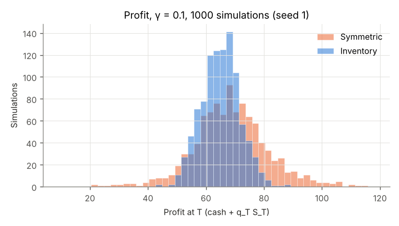
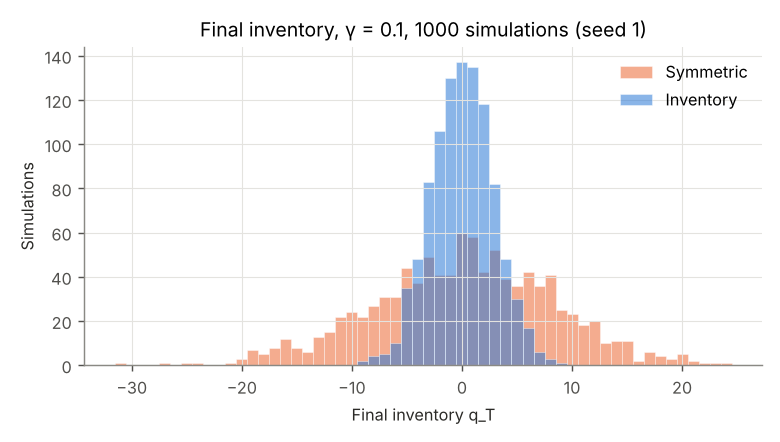
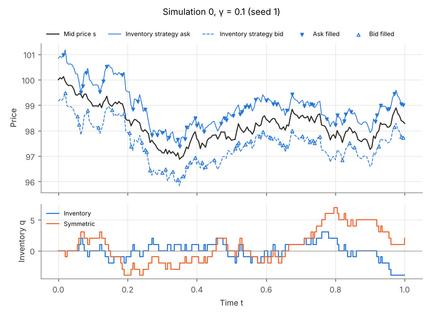
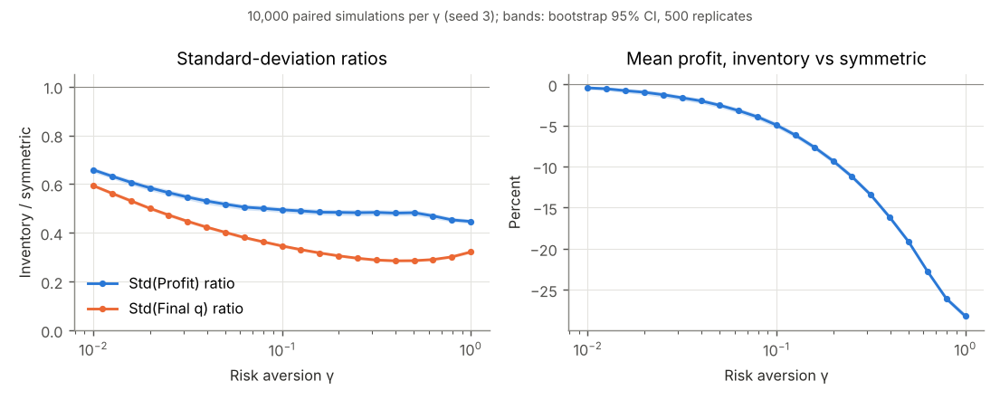

# Replication: Avellaneda and Stoikov (2008), numerical simulations

Reproduces the simulation study of M. Avellaneda and S. Stoikov, "High-frequency trading in a
limit order book", *Quantitative Finance* 8(3), 217-224 (2008): a market maker who quotes around
the inventory-adjusted reservation price, compared with one who quotes the same average spread
symmetrically around the mid. The paper's own table values are in
`reference/as2008_tables.csv`. They were read from the PDF at math.nyu.edu/~avellane through a
text-extraction tool (three reads agreed). They are the only hand-typed numbers here.

## Model as implemented

Parameters as in the paper: $S_0 = 100$, $\sigma = 2$, $T = 1$, $dt = 0.005$ ($N = 200$),
$A = 140$, $k = 1.5$, $q_0 = 0$, one unit per fill, 1000 simulations per $\gamma$. At each step
$t_n = n\,dt$, $n = 0, \dots, N-1$, in the paper's order:

1. Quote. Inventory strategy: $r = s - q\gamma\sigma^2(T-t)$, spread
   $\gamma\sigma^2(T-t) + \tfrac{2}{\gamma}\ln(1+\gamma/k)$, bid and ask at $r \mp$ spread$/2$.
   Symmetric strategy: mid $\mp \bar s/2$, where $\bar s$ is the inventory strategy's spread
   averaged over the quoting times. This is the paper's benchmark ("the average bid/ask spread of the
   inventory strategy over the time period, centred around the mid-price").
2. Fill. The ask fills with probability $\min(1, A e^{-k\delta^a} dt)$, with $\delta^a$ = ask $-$ mid. The bid
   is handled the same way, with an independent draw. Both can fill in one step: inventory is then
   unchanged and cash gains the quoted spread. Fills execute at the quoted price.
3. Move the mid: $s \leftarrow s + \sigma\sqrt{dt}\,Z$, with $Z$ standard normal.

Profit is $X_T + q_T S_T$ (cash plus inventory marked at the final mid).

**Choices and deviations, stated explicitly.**
- The paper's third risk aversion is $\gamma = 1$, not 0.5. The tables follow the paper. The sweep
  figure covers $0.01 \le \gamma \le 1$.
- The paper says only that the mid "is updated by a random increment". Gaussian increments are used
  here, matching its Brownian model.
- The paper does not state its profit formula for the tables. $X_T + q_T S_T$ is the quantity in its
  utility objective.
- Quotes through the mid. A large inventory can push the inventory strategy's ask below the mid
  ($\delta^a < 0$). The intensity formula is applied as written, with the probability capped at 1.
  The paper does not discuss this case.
- Average spread. $\bar s$ is the mean over the $N$ quoting times. At $\gamma = 1$ the paper prints
  3.02, which matches the continuous-time average $\gamma\sigma^2 T/2 + \tfrac{2}{\gamma}\ln(1+\gamma/k)$.
  The grid average is higher by $\gamma\sigma^2 dt/2$ (Table 1). This is a small difference in
  the benchmark's spread, not in the inventory strategy.
- Extra benchmark, not in the paper: "Symmetric (time-matched)" quotes mid $\mp$ spread$(t)/2$, so
  its spread equals the inventory strategy's at every step. Its rows are in
  `results/paper/tables.md`. Table 2 below uses the paper's benchmark.
- No tick grid, no inventory limit and no order book: this is the paper's reduced-form model.

**Paired design.** Simulation $i$ draws its normals and fill uniforms from
`Rng::for_stream(seed, i)`. Every strategy and every $\gamma$ runs on the same paths and the same
uniforms (common random numbers). The comparisons are therefore paired.

**Intervals.** Paired percentile bootstrap. Each replicate draws $n$ simulation indices with
replacement and applies the same indices to both strategies. It recomputes the ratio of sample
standard deviations ($n-1$ divisor) of profit and of final inventory, and
$(\bar\pi_{\text{inv}} - \bar\pi_{\text{sym}})/\bar\pi_{\text{sym}}$. The 95% interval runs from
the 2.5% to the 97.5% quantile of the replicates (type 7).

**Agreement test.** The paper's numbers come from one run of 1000 simulations, so each one is
compared with the sampling spread of a 1000-simulation estimate. That spread is measured by
splitting the large run into independent blocks of 1000 and taking the standard deviation of each
statistic across blocks. Then $z$ = (paper $-$ large-run estimate) / block SD. The paper's
rounding to one decimal is ignored, and the 30 statistics are correlated, so this is a sanity
check, not a formal test.

## Results

<!-- tables:begin -->
**Table 1.** Layout of the paper's tables (Section 3.3 of the author's PDF). Seeds: 1000-sim run 1, 100,000-sim run 2.

| γ | Strategy | Source | Avg spread | Profit | Std(Profit) | Final q | Std(Final q) |
|---|---|---|---|---|---|---|---|
| 0.1 | Inventory | paper, 1000 sims | 1.49 | 65.0 | 6.6 | 0.08 | 2.9 |
| 0.1 | Inventory | here, 1000 sims | 1.492 | 65.0 | 6.5 | 0.03 | 2.8 |
| 0.1 | Inventory | here, 100,000 sims | 1.492 | 64.9 | 6.5 | 0.01 | 2.9 |
| 0.1 | Symmetric | paper, 1000 sims | 1.49 | 68.4 | 12.7 | 0.26 | 8.4 |
| 0.1 | Symmetric | here, 1000 sims | 1.492 | 68.6 | 12.9 | 0.05 | 8.2 |
| 0.1 | Symmetric | here, 100,000 sims | 1.492 | 68.2 | 13.4 | 0.02 | 8.4 |
| 0.01 | Inventory | paper, 1000 sims | 1.35 | 68.6 | 8.7 | 0.12 | 5.1 |
| 0.01 | Inventory | here, 1000 sims | 1.349 | 68.6 | 8.9 | -0.05 | 5.1 |
| 0.01 | Inventory | here, 100,000 sims | 1.349 | 68.4 | 9.0 | 0.01 | 5.2 |
| 0.01 | Symmetric | paper, 1000 sims | 1.35 | 68.8 | 12.8 | 0.09 | 8.7 |
| 0.01 | Symmetric | here, 1000 sims | 1.349 | 68.9 | 13.1 | -0.01 | 8.5 |
| 0.01 | Symmetric | here, 100,000 sims | 1.349 | 68.6 | 13.6 | 0.03 | 8.7 |
| 1 | Inventory | paper, 1000 sims | 3.02 | 31.4 | 5.0 | 0.02 | 1.7 |
| 1 | Inventory | here, 1000 sims | 3.032 | 31.4 | 4.8 | 0.01 | 1.6 |
| 1 | Inventory | here, 100,000 sims | 3.032 | 31.4 | 4.9 | 0.00 | 1.6 |
| 1 | Symmetric | paper, 1000 sims | 3.02 | 44.0 | 11.0 | 0.00 | 5.1 |
| 1 | Symmetric | here, 1000 sims | 3.032 | 44.1 | 11.0 | -0.01 | 5.2 |
| 1 | Symmetric | here, 100,000 sims | 3.032 | 43.7 | 10.7 | 0.02 | 5.2 |

**Table 2.** Inventory strategy relative to a symmetric benchmark: estimate and paired percentile-bootstrap 95% interval (2000 replicates for 1000 sims, 1000 for 100,000).

| γ | Benchmark | Sims | Std(Profit) ratio | Std(Final q) ratio | Mean profit, relative difference |
|---|---|---|---|---|---|
| 0.1 | Symmetric | 1000 | 0.506 [0.474, 0.541] | 0.344 [0.324, 0.364] | -5.27% [-6.19, -4.35] |
| 0.1 | Symmetric | 100,000 | 0.488 [0.484, 0.491] | 0.348 [0.346, 0.350] | -4.88% [-4.98, -4.78] |
| 0.01 | Symmetric | 1000 | 0.680 [0.652, 0.709] | 0.601 [0.578, 0.625] | -0.42% [-1.10, +0.27] |
| 0.01 | Symmetric | 100,000 | 0.658 [0.655, 0.661] | 0.598 [0.596, 0.600] | -0.36% [-0.43, -0.28] |
| 1 | Symmetric | 1000 | 0.435 [0.411, 0.461] | 0.315 [0.297, 0.335] | -28.82% [-29.77, -27.88] |
| 1 | Symmetric | 100,000 | 0.454 [0.452, 0.457] | 0.318 [0.316, 0.320] | -28.04% [-28.14, -27.94] |

**Agreement with the paper.** Of the 30 paper statistics compared (means and standard deviations of profit and final inventory, and the two standard-deviation ratios, for γ = 0.1, 0.01, 1), 30 lie within 2 standard deviations of a 1000-simulation estimate from this model (|z| ≤ 2). The largest deviation is sd_profit (symmetric) at γ = 0.01 (paper 12.8, here 13.6, z = -1.9).

<!-- tables:end -->

The full tables, including the time-matched benchmark and the per-statistic $z$ values (Table 3),
are in `results/paper/tables.md` and `results/paper/agreement.csv`.

**Reading.** The replication agrees with the paper's table within sampling error. The
qualitative claim holds at every $\gamma$ tested. With the same average spread, inventory-aware
quoting has a much smaller standard deviation of profit and of final inventory (Table 2: the
intervals lie far below 1). The cost is lower mean profit: negligible at $\gamma = 0.01$ and large
at $\gamma = 1$. The time-matched benchmark earns about what the constant-spread one does, so the
cost comes from the skew (giving up edge to unload inventory), not from the spread's time profile.
The largest gaps in Table 3 are the paper's symmetric Std(Profit) at $\gamma = 0.1$ and $0.01$.
The paper's values are below this model's, but within 2 SD. Nothing was tuned: the seeds were fixed
before any results were seen.

| | |
|---|---|
|  |  |
|  |  |

## Reproduce

```sh
cmake -S . -B build-paper -G Ninja -DCMAKE_BUILD_TYPE=Release
cmake --build build-paper --target paper_replication paper_tests
ctest --test-dir build-paper -R paper --output-on-failure
paper/reproduce.sh build-paper   # runs, then make_tables.py and plot.py
```

`paper/reproduce.sh` runs three experiments: 1000 simulations (seed 1), 100,000 (seed 2) and
the $\gamma$ sweep (10,000 per value, seed 3). It records the commands, seeds and git commit in
`results/paper/MANIFEST.txt`. Each run writes `run.txt`, `summary.csv` and `comparison.csv`, plus
`sims.csv` (one row per simulation), `blocks.csv` or `trace.csv` as requested. Run
`build-paper/paper/paper_replication --help` for the flags. Output is deterministic for a given seed
and build. Across C libraries, `log`, `sin` and `cos` can differ in the last bit, so results on
another platform are only statistically identical.
